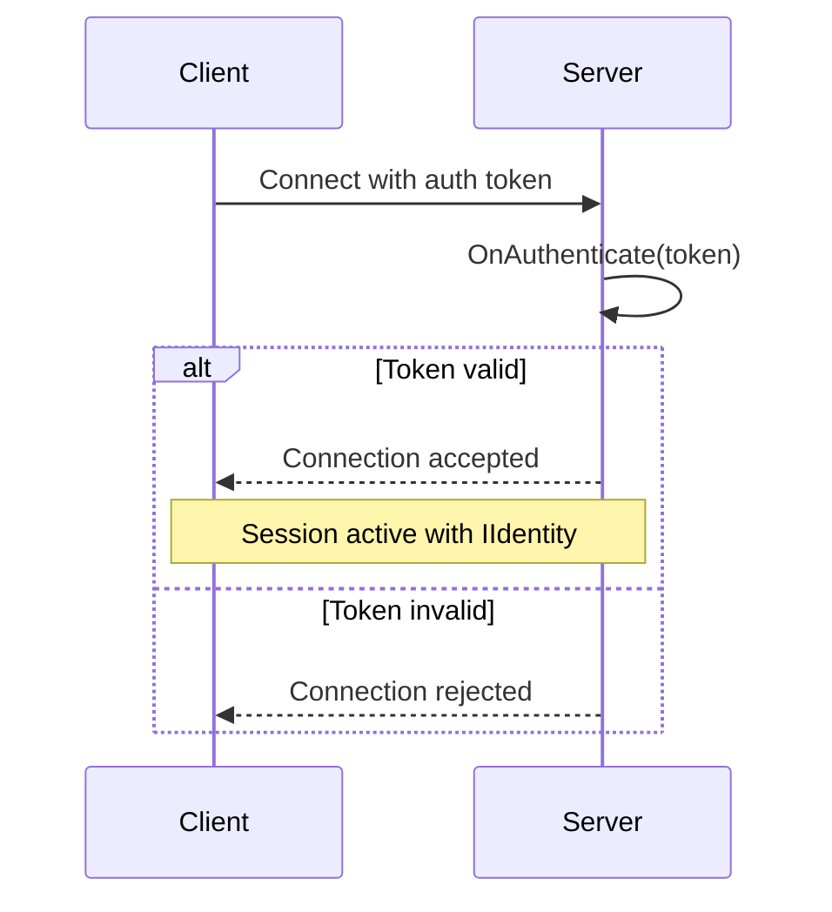

# Authentication

NexNet supports token-based authentication at the connection level. When enabled, clients must provide an authentication token during connection, and the server validates it before allowing the session to proceed.

## Enabling Authentication

Authentication is disabled by default for backward compatibility. Enable it on the server config:

```csharp
var serverConfig = new TcpServerConfig
{
    EndPoint = new IPEndPoint(IPAddress.Any, 5000),
    Authenticate = true
};
```

## Server-Side Validation

Override `OnAuthenticate` in your server nexus to validate client tokens. Return an `IIdentity` on success, or `null` to reject the connection:

```csharp
[Nexus<IServerNexus, IClientNexus>(NexusType = NexusType.Server)]
public partial class ServerNexus
{
    protected override ValueTask<IIdentity?> OnAuthenticate(ReadOnlyMemory<byte> authToken)
    {
        if (ValidateToken(authToken))
            return new ValueTask<IIdentity?>(new UserIdentity("username"));

        return new ValueTask<IIdentity?>((IIdentity?)null);
    }
}
```

Over TLS, `Context.RemoteCertificate` holds the client certificate inside `OnAuthenticate`, so the token and the certificate can be checked together. See [TLS and Certificates](transports.md#tls-and-certificates).

On an ASP.NET server (WebSocket and HttpSocket), `Context.User` holds the request's `ClaimsPrincipal` inside `OnAuthenticate`, so the claims ASP.NET authentication produced can be mapped to an `IIdentity`. See [ASP.NET Integration](asp-net-integration.md#the-aspnet-principal).

The `IIdentity` returned by `OnAuthenticate` is available throughout the session via `Context.Identity`, which is used by the [Authorization](authorization.md) system for method-level access control.

## Client-Side Token

Provide the authentication token on the client config via the `Authenticate` delegate:

```csharp
var clientConfig = new TcpClientConfig
{
    EndPoint = new IPEndPoint(IPAddress.Loopback, 5000),
    Authenticate = () => Encoding.UTF8.GetBytes("my-auth-token")
};
```

The delegate is called each time the client connects (including reconnections), allowing you to refresh tokens as needed.

The greeting token is the canonical mechanism for every client, including browsers, which cannot send an `Authorization` header on a WebSocket. On an ASP.NET server, an opt-in query-string token (`AccessTokenQueryParameter`) exists only for ASP.NET authentication that must run before the upgrade. When browsers connect with cookies, set `AllowedOrigins`. See [ASP.NET Integration: Browser Clients](asp-net-integration.md#browser-clients).

### Asynchronous token

When the token comes from an asynchronous source, such as an identity provider or a refresh call, set `AuthenticateAsync` instead:

```csharp
var clientConfig = new TcpTlsClientConfig
{
    EndPoint = new IPEndPoint(IPAddress.Loopback, 5000),
    SslClientAuthenticationOptions = new() { TargetHost = "server.example.com" },
    AuthenticateAsync = async cancellationToken =>
    {
        var token = await tokenProvider.GetTokenAsync(cancellationToken);
        return Encoding.UTF8.GetBytes(token);
    }
};
```

- It is called on every connect and reconnect, before the transport connects. No connection is opened until the token is ready, so a slow provider does not use up the server's handshake timeout.
- It must complete within the client's `HandshakeTimeout`. Its `CancellationToken` is canceled at that point, or when the `CancellationToken` passed to `ConnectAsync`/`TryConnectAsync` is canceled.
- If it throws, the connect fails: `TryConnectAsync` returns `StateValue.Exception` with `DisconnectReason.Authentication` and the exception, and `ConnectAsync` rethrows it. A timeout fails the same way with a `TransportException` whose `Error` is `TransportError.AuthenticationError`. A canceled connect returns `StateValue.Canceled`.
- `Authenticate` and `AuthenticateAsync` are mutually exclusive. Setting both throws `InvalidOperationException` when the client is created, or fails the connect if both are set later.

## Plaintext Transports

The token travels in the connection greeting, so on an unencrypted transport anyone on the network path can read it. Use TLS, `wss://` or `https://` whenever the token or the data matters.

`INexusClient.IsSecure` reports whether the client's transport protects the connection:

| Transport | `IsSecure` |
|---|---|
| TCP + TLS (`TcpTlsClientConfig`) | true |
| QUIC | true |
| Unix domain sockets (local to the machine) | true |
| WebSocket / HttpSocket with a `wss://` / `https://` URL | true |
| Plain TCP (`TcpClientConfig`) | false |
| WebSocket / HttpSocket with a `ws://` / `http://` URL | false |

`NexusClient.GetSnapshot()` carries the same value in `NexusSessionSnapshot.IsSecure` (null on server sessions).

When `IsSecure` is false, the client logs one warning per client instance on its first connect:

```
NexNet: unencrypted transport (tcp); credentials and data are visible on the network.
```

The transport is named `tcp`, `ws://` or `http://`. Plaintext connections still work; the warning is informational.

A custom `ClientConfig` subclass is treated as plaintext unless it overrides `IsSecureTransport` to return true, so it gets `IsSecure` false and the warning. The warning names it by its `TransportName`, or by its type name when it does not set one:

```csharp
public sealed class MyTransportClientConfig : ClientConfig
{
    protected internal override bool IsSecureTransport => true; // only if the transport encrypts or is local
    // ...
}
```

## Connection Flow



## See Also

- [Authorization](authorization.md) — Method-level access control using the authenticated identity
- [ASP.NET Integration](asp-net-integration.md) — Authentication via ASP.NET middleware and bearer tokens
