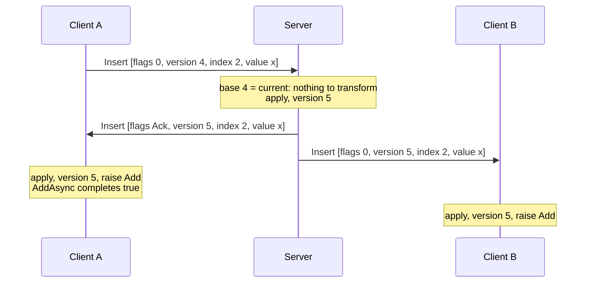

# NexNet Wire Protocol (version 1)

This document specifies the bytes NexNet sends over a transport (TCP, TLS, UDS, QUIC, WebSocket, HttpSocket).
It covers the connection preamble, message framing, every protocol message body, flow control, the payload encoding
rules for user types, and limits. The design behind the flow control, large values and hostile-peer limits is described in
[flow-control.md](flow-control.md). How each transport carries the byte stream is in §13.

Two encodings are used:

- **Framing** is NexNet's own envelope. Its multi-byte fields (the body length and the post-headers) are
  **little-endian**.
- **Message bodies** (except `DuplexPipeWrite` and `MessageChunk`) are
  [MessagePack](https://github.com/msgpack/msgpack/blob/master/spec.md), whose multi-byte numbers are **big-endian**
  as the spec requires.

## 1. Connection preamble

Each side sends an 8-byte header once, immediately after the transport connects:

| Offset | Size | Value |
|---|---|---|
| 0 | 4 | Magic `4E 6E 50 14` (`N`, `n`, `P`, DC4) |
| 4 | 3 | Reserved, must be `00 00 00` |
| 7 | 1 | Protocol version, `1` |

The peer closes the connection with `DisconnectProtocolError` (disconnect reason `ProtocolError`) if:
- the magic bytes differ,
- any reserved byte is non-zero, or
- the protocol version differs from its own.

Message bodies are only defined by this specification. A peer that sends the same preamble but a different body
encoding is disconnected with `ProtocolError` as soon as its first message fails to decode.

## 2. Framing

After the preamble the stream is a sequence of messages:

| Field | Size | Notes |
|---|---|---|
| Type | 1 | `MessageType` value (§3) |
| Body length | 2 | **little-endian** `uint16`; present only for types with a body |
| Post-header | 0, 2 or 3 | `DuplexPipeWrite` and `PipeWindowUpdate`: pipe ID as `[client id][server id]`. `MessageChunk`: invocation ID (`uint16`, little-endian), then the kind (`uint8`, §4.10) |
| Body | *length* | MessagePack (§4), or raw bytes for `DuplexPipeWrite` and `MessageChunk` |

The maximum body is 65,535 bytes. The body length does not count the post-header. Arguments and results larger than
one frame are streamed with `MessageStart` / `MessageChunk` (§6); other data larger than a frame goes through pipes
(§7).

Before the connection completes (§5), a body longer than 16 KiB is a protocol error, detected as soon as the length
is read.

### Pipe IDs

A pipe ID is a pair of one-byte local IDs: the client's and the server's.
- In frames it is written as two bytes, client byte first.
- Inside MessagePack bodies it is a `uint16` whose value is defined as `clientId | (serverId << 8)`.

Both forms are independent of host byte order.

## 3. Message types

| Value | Name | Body | Sent by |
|---|---|---|---|
| 1 | Ping | none | both |
| 20–38 | Disconnect* | none | both |
| 50 | DuplexPipeWrite | raw pipe bytes | both |
| 51 | PipeWindowUpdate | `uint32` LE credit (§7.2) | both |
| 100 | ClientGreeting | §4.1 | client |
| 101 | ClientGreetingReconnection | §4.1 | client |
| 105 | ServerGreeting | §4.2 | server |
| 110 | Invocation | §4.3 | both |
| 111 | InvocationCancellation | §4.5 | both |
| 112 | InvocationResult | §4.4 | both |
| 113 | MessageStart | §4.8 | both |
| 114 | MessageChunk | raw payload | both |
| 115 | MessageAbort | §4.9 | both |
| 116 | InvocationCredit | §4.7 | both |
| 120 | DuplexPipeUpdateState | §4.6 | both |

Every byte in 20–38 is read as a disconnect reason before anything else; no other message type uses that range.
Defined disconnect reasons: 20 SocketError, 21 Graceful, 22 ProtocolError, 23 Timeout, 24 ClientMismatch,
25 ServerMismatch, 28 ServerShutdown, 29 Authentication, 30 ServerRestarting, 32 SocketClosedWhenWriting,
33 RateLimited, 34 Unauthorized, 35 FlowControl (credit or window violation), 37 Stalled (no progress within the
progress timeout, §9). 26, 27, 31, 36 and 38 are not assigned, but are still disconnects (§5.6).

A server rejects `ServerGreeting`, and a client rejects `ClientGreeting*`, with `DisconnectProtocolError`.
Any type not listed here is a protocol error.

## 4. Message bodies

Every MessagePack body is a **fixed-length MessagePack array**. Readers require the exact element count and reject
trailing bytes.

**"Embedded value"** means a payload value (§10) encoded inline as exactly one MessagePack value. It is never
wrapped in `bin` or length-prefixed.

### 4.1 ClientGreeting / ClientGreetingReconnection
`[version: str|nil, serverNexusHash: int, clientNexusHash: int, authenticationToken: bin, maxMessageSize: int, invocationCredits: int]`

- `authenticationToken` is `bin` or `nil`, at most 8 KiB; a longer one is rejected from its `bin` header, before it
  is read (§5.4).
- `maxMessageSize`: the largest argument, result or channel item the client accepts (§9).
- `invocationCredits`: how many invocations the server may have queued at the client (§4.7).

### 4.2 ServerGreeting
`[version: int, clientId: int64, maxMessageSize: int, invocationCredits: int]`

`version` is the hash of the **client** nexus the server expects (§5.2), not a version string. `clientId` is the
session ID the server assigned.

`maxMessageSize` and `invocationCredits` have the same meaning for the server. A side whose advertised
`maxMessageSize` is below one frame (65,526 bytes) or whose `invocationCredits` is below 1 is disconnected with
`ProtocolError`.

### 4.3 Invocation
`[invocationId: uint16, methodId: uint16, flags: uint8, arguments: array]`

`arguments` is an embedded array with one element per serialized parameter, in declaration order:
- `CancellationToken` parameters are not sent.
- Pipe and channel parameters are sent as their initial pipe ID byte.
- Methods without serialized parameters send an empty array (`0x90`).

`flags`: bit 0 IgnoreReturn (no result is sent), bit 1 DuplexPipe. An invocation whose body exceeds one frame is
streamed (§6). The `invocationId` of an IgnoreReturn invocation has no meaning and need not be unique; senders use
0. The exception is a streamed one: its ID keys the stream (§6), so it is unique among the sender's outstanding
invocations until the stream has been sent. A receiver must not use the ID of an IgnoreReturn invocation to identify
it; nothing can cancel such an invocation except the session ending.

**Method ID validation.** A receiver accepts an `Invocation` only if `methodId` is a method or collection of its own
nexus in the negotiated version: on the server, the version selected by the greeting (§5.2); on the client, its
client nexus. Any other `methodId` disconnects with `ProtocolError`. The check runs before the invocation credit is
counted (§8); a streamed invocation is checked once it has been reassembled. The C# implementation looks up the
int64 key `(versionHash << 16) | methodId` in a generated set, where `versionHash` is the negotiated version's
nexus hash. Another implementation may keep any equivalent set of the method IDs it implements.

Source: `src/NexNet/Internals/NexusSession.Receiving.cs` (the `Invocation` case), `VMHash` and
`VersionMethodHashSet` in `src/NexNet.Generator/Emission/NexusEmitter.cs`.

### 4.4 InvocationResult
- No result (void methods, exceptions, unauthorized): `[invocationId: uint16, state: uint8]`
- With a result, which may itself be nil: `[invocationId: uint16, state: uint8, result: embedded value]`

`state`: 0 Unset, 1 CompletedResult, 2 Exception, 3 Unauthorized, 4 Canceled. An invocation without IgnoreReturn gets
exactly one result, unless the session ends first; that includes a method that was canceled (by an
InvocationCancellation or on its own), which gets Canceled. A result for an invocation ID the receiver is not waiting on is a protocol
error. A result whose body exceeds one frame is streamed (§6).

An Exception result may carry a detail as its third element: an array of exactly 3,
`[code: int32|nil, type: str|nil, message: str|nil]`, the application error code, the exception's type name and its
message. Without a detail it is `[invocationId, state]`. Senders truncate `type` to 256 and `message` to 2048 UTF-16
chars, never splitting a surrogate pair. A receiver ignores a detail that has another shape, a code outside int32 or
longer strings, and treats the result as an Exception without detail; this is never a protocol error. Peers that do
not read the detail accept it as an embedded value.

### 4.5 InvocationCancellation
`[invocationId: uint16]`

Asks the receiver to cancel an invocation it has received, including one still queued for execution: that one starts
with its cancellation token already canceled. The receiver still sends its result (§4.4), Canceled if the method
stopped. A cancellation for an invocation that has already completed is ignored. The canceling side keeps the invocation ID outstanding until that result arrives, so the result is not a
protocol error and the ID is not reused before it.

#### Caller-side cancellation

A caller may cancel an invocation that expects a result (no IgnoreReturn). What happens depends on whether the
invocation has been sent:

- **Canceled before it is sent.** This covers a token that is already canceled and a cancel while the call waits for
  invocation credit (§8). Nothing is sent, no invocation ID stays reserved, and the call completes as canceled.
- **Canceled after it is sent** (or while it is being written). The caller completes the call as canceled at once,
  without waiting for the peer, and sends `InvocationCancellation`. It keeps the invocation ID outstanding until the
  peer's `InvocationResult` arrives. That late result, whatever its state, is consumed and discarded, which then
  releases the ID. It is not a protocol error.
- **Canceled while a large argument is streaming** (§6). The caller stops, sends `MessageAbort(Cancelled)`, and
  completes the call like a call canceled before it was sent. The method never runs, so no result follows.
- **Session ends.** Every call still waiting completes as canceled.

IgnoreReturn invocations can't be canceled.

**Current C# behavior:** for the first case, the C# client returns without a result: a `ValueTask` method returns
normally and a `ValueTask<T>` method returns `default`. The same applies to the large-argument case. Unit F03
changes the C# client to throw `TaskCanceledException`, which is the required behavior for other clients (Java:
`CancellationException`; JavaScript: `AbortError`). Neither case puts anything on the wire, so the difference is
not visible to the peer.

Source: `src/NexNet/Invocation/SessionInvocationStateManager.cs` (`InvokeMethodWithResultCore`,
`CancelInvocation`, `UpdateInvocationResult`), `src/NexNet/Internals/RegisteredInvocationState.cs`.

### 4.6 DuplexPipeUpdateState
`[pipeId: uint16, state: uint8, window: uint32]`

`state` is a set of flags:

| Bit | Name | Meaning |
|---|---|---|
| 0 | ClientWriterServerReaderComplete | the client-to-server direction is complete |
| 1 | ClientReaderServerWriterComplete | the server-to-client direction is complete |
| 2 | Ready | the pipe is open (sent by the side that registers it) |
| 3 | Refused | the open was refused because a limit is reached; sent instead of Ready, with the opener's partial pipe ID |

`Complete` is bits 0–2 together. `window` is the receive credit granted with Ready (§7.1) and 0 otherwise.

### 4.7 InvocationCredit
`[credits: uint16]`

Returns `credits` invocation credits to the peer (§8). `credits` is at least 1; `InvocationCredit[0]` disconnects
with `FlowControl`.

### 4.8 MessageStart
`[invocationId: uint16, kind: uint8, innerType: uint8, totalLength: uint32]`

Starts a large message (§6). `kind` is 0 Argument (`innerType` 110, Invocation) or 1 Result (`innerType` 112,
InvocationResult). `totalLength` is the length of the inner message's body.

### 4.9 MessageAbort
`[invocationId: uint16, kind: uint8, reason: uint8]`

`reason`: 0 Busy, 1 TooLarge, 2 Cancelled, 3 Ack (§6.3).

### 4.10 MessageChunk
Post-header `[invocationId: uint16 LE][kind: uint8]`, body: the next bytes of the inner message's body.

### 4.11 Collection synchronization (channel items on the collection pipe)

Each item is a union value: `[tag: uint16, body: array]`, framed as a channel item (§7.4). The first element of
every body is `flags: uint8`. What each item means, and the client state machine, are in §12.

| Tag | Message | Body |
|---|---|---|
| 0 | ResetStart | `[flags, version: int, totalValues: int]` |
| 1 | ResetValues | `[flags, values: embedded T[]]` |
| 2 | ResetComplete | `[flags]` |
| 3 | Clear | `[flags, version: int]` |
| 4 | Insert | `[flags, version: int, index: int, value: embedded T]` |
| 5 | Replace | `[flags, version: int, index: int, value: embedded T]` |
| 6 | Move | `[flags, version: int, fromIndex: int, toIndex: int]` |
| 7 | Remove | `[flags, version: int, index: int]` |
| 8 | Noop | `[flags]` |

## 5. Connection completion

The client sends its greeting after the preamble and nothing else until it receives `ServerGreeting`. The server
validates the greeting, runs authentication if configured, and then sends `ServerGreeting`. Until then:
- only a greeting is accepted; any other message is a protocol error;
- the body cap of §2 applies.

Each side applies the peer's advertised `maxMessageSize` and `invocationCredits` once the connection completes (the
server only after authentication). A side's send limit is the smaller of its own `maxMessageSize` and the peer's;
it always enforces its own limit on what it receives.

### 5.1 Before the connection completes

The rules are the same on both sides. A side's connection completes:
- on the server, after the greeting is validated and authentication succeeds, just before `ServerGreeting` is sent;
- on the client, when it receives a valid `ServerGreeting`.

Until then the side accepts only:
- a disconnect byte (20–38, §5.6), which is read before anything else;
- one greeting of the right direction: `ClientGreeting`/`ClientGreetingReconnection` on the server,
  `ServerGreeting` on the client.

Anything else is a `ProtocolError`, and so is a greeting of the wrong direction. That includes `Ping`: a client must
not ping before `ServerGreeting` arrives (§5.5). A frame body longer than 16 KiB is a `ProtocolError` as soon as
its length is read (§2).

The client sends the preamble and its greeting, then nothing else until `ServerGreeting`. The server sends
nothing but its preamble, then `ServerGreeting` or a disconnect.

Each side also runs a **handshake timeout** (`HandshakeTimeout`, 15 s by default, real time), started when its
read loop starts. If the connection has not completed by then, the side closes the transport with reason
`Timeout` and sends **no** disconnect byte. On the server the timeout includes the time spent in
`OnAuthenticate`.

Source: `src/NexNet/Internals/NexusSession.Receiving.cs` (`Process`, the pre-completion check), and
`src/NexNet/Internals/NexusSession.cs` (`MaxPreAuthBodyLength`, `CheckHandshakeComplete`).

### 5.2 Greeting validation

The nexus hashes are **opaque int32 constants** produced by the NexNet source generator from the nexus
interfaces. A client in another language takes them from the generator output and never recomputes them. Three
hashes are involved:

| Hash | Meaning |
|---|---|
| client nexus hash | hash of the client nexus interface (the methods the server may invoke on the client) |
| server nexus hash | hash of the server nexus interface, or of one of its `[NexusVersion]` versions |
| versions table | a versioned server's map from version string to that version's hash |

The client fills its greeting as follows:
- `version`: the newest version string of the server nexus it was generated against, or nil if that nexus is
  not versioned. A non-nil version is at most 16 characters.
- `serverNexusHash`: the hash of that version, or the server nexus hash if unversioned.
- `clientNexusHash`: its client nexus hash.

The server checks the greeting in this order. The first failure ends the session; the server sends the disconnect
byte (§5.6).

| # | Check | Disconnect |
|---|---|---|
| 1 | More than 3 greetings on this connection (see the note below) | `ProtocolError` |
| 2 | A greeting was already received on this connection | `ProtocolError` |
| 3 | The body does not decode, or `authenticationToken` is longer than 8 KiB | `ProtocolError` |
| 4 | `version` is longer than 16 UTF-16 code units | `ProtocolError` |
| 5 | `clientNexusHash` differs from the server's client nexus hash | `ClientMismatch` |
| 6 | `maxMessageSize` below 65,526, or `invocationCredits` below 1 | `ProtocolError` |
| 7 | Unversioned server and `version` is not nil | `ServerMismatch` |
| 8 | Versioned server and `version` is nil or not in its versions table | `ServerMismatch` |
| 9 | `serverNexusHash` differs from the hash of the requested version (unversioned: the server nexus hash) | `ServerMismatch` |
| 10 | Authentication is configured and `OnAuthenticate` throws or returns no identity | `Authentication` |

If all checks pass, the server completes the connection and sends `ServerGreeting` with `version` set to its client
nexus hash. The version negotiated by checks 7–9 selects the method set for §4.3.

**Greeting attempts.** The server counts greetings and refuses a fourth (check 1). Check 2 refuses any second
greeting anyway, so in practice exactly one greeting is accepted per connection, and a client that wants to retry
opens a new connection.

The client checks `ServerGreeting` in this order:

| # | Check | Disconnect |
|---|---|---|
| 1 | A `ServerGreeting` was already received | `ProtocolError` |
| 2 | `version` differs from its own client nexus hash | `ClientMismatch` |
| 3 | `maxMessageSize` below 65,526, or `invocationCredits` below 1 | `ProtocolError` |

Source: `src/NexNet/Internals/NexusSession.Receiving.cs` (`MessageHandler`, the `ClientGreeting` and
`ServerGreeting` cases; `CompleteServerHandshake`), `src/NexNet/Internals/NexusSession.cs` (`StartAsClient`,
`MaxVersionStringLength`, `MaxGreetingAttempts`, `ApplyPeerLimits`).

### 5.3 ClientGreeting and ClientGreetingReconnection

`ClientGreetingReconnection` (101) has the same body as `ClientGreeting` (100). The C# client sends 101 when it
reconnects under its reconnection policy, and 100 otherwise. The server treats 101 exactly like 100: the same checks
apply, and it creates a new session. Nothing from the earlier session is resumed: pipes, collections, invocations
and the session ID are all new. Session resumption is not implemented. A new client may always send 100.

Source: `src/NexNet/Internals/NexusSession.Receiving.cs` (the `ClientGreetingReconnection` case falls through to
`ClientGreeting`), `src/NexNet/Internals/NexusSession.cs` (`StartAsClient`).

### 5.4 Authentication token

`authenticationToken` is `bin` or `nil`. Senders send an empty `bin` (`c4 00`) when they have no token; readers
treat `nil` like an empty token. The length is checked against 8,192 bytes from the `bin` header, before the
bytes are read; a longer token is a `ProtocolError`.

The server passes the token bytes to its authentication handler only when authentication is configured;
otherwise it ignores them. The token never appears anywhere else in the protocol.

Source: `src/NexNet/Messages/IClientGreetingMessageBase.cs` (`ReadAuthenticationToken`),
`src/NexNet/Messages/ClientGreeting.cs`.

### 5.5 Ping and idle timeout

`Ping` (type 1) is a single byte with no length and no body.

- **Only the client pings.** Every `PingInterval` (10 s by default), starting once the connection completes, the
  client first checks its idle timeout and then sends `Ping`.
- **The server only replies.** For every `Ping` it receives, it sends a `Ping` back. Pings that arrive before the
  reply is sent may be answered with a single `Ping`. The server never pings on its own.
- **The idle timeout is local to each side** and is not advertised. Each side disconnects with `Timeout` (sending
  the disconnect byte) when it has received no complete frame for `Timeout` (30 s by default). Any complete frame
  counts, not only `Ping`; a partial frame does not. The server checks every `Timeout` / 4. The client checks on
  each ping tick.

So a client must ping well within the server's idle timeout, which it cannot learn from the protocol today.

**Forward note:** unit S04 adds a trailing field `idleTimeoutMs` to `ServerGreeting`. Clients will derive their
ping interval from it (a third of it by default). Older readers ignore trailing fields.

Source: `src/NexNet/NexusClient.cs` (`PingTimer`), `src/NexNet/NexusServer.cs` (`ConnectionWatchdog`),
`src/NexNet/Internals/NexusSession.Receiving.cs` (the `Ping` case), `src/NexNet/Internals/SessionControlSender.cs`
(`RequestPong`), `src/NexNet/Internals/NexusSession.cs` (`DisconnectIfTimeout`).

### 5.6 Disconnect

A disconnect is a single byte, the reason (20–38), with no length and no body.

**Receiving.** A byte in 20–38 read where a message type is expected ends the session at once with that reason.
This holds in every state, including before the connection completes. The receiver:
- does not process any bytes after it;
- does not reply;
- closes the transport.

Unassigned codes in the range (26, 27, 31, 36, 38) are still disconnects, reported with their numeric value.

**Sending.** A side that ends the session for a reason the peer should know writes the disconnect byte, waits
`DisconnectDelay` (200 ms by default; 0 disables the wait; at most 10 s) so the byte can reach the wire, and then
closes the transport. Nothing is sent after the disconnect byte.

| Cause | Reason | Byte sent |
|---|---|---|
| Application disconnect (`DisconnectAsync`) | `Graceful` | yes |
| Server stopping | `ServerShutdown` | yes |
| Protocol violation detected while reading, including a bad preamble | `ProtocolError` or the specific reason | yes |
| Greeting rejected (§5.2) | as listed there | yes |
| Idle timeout (§5.5) | `Timeout` | yes |
| Progress timeout (§9) | `Stalled` | yes |
| Authorization returns Disconnect (§7.6) | `Unauthorized` | yes |
| Handshake timeout (§5.1) | `Timeout` | no |
| Transport ended or failed | `SocketError` | no |
| Disconnect byte received | the received reason | no |

Source: `src/NexNet/Internals/NexusSession.Receiving.cs` (`Process`, the 20–38 check),
`src/NexNet/Internals/NexusSession.cs` (`DisconnectCore`, `DisconnectStartedCore`),
`src/NexNet/Transports/ConfigBase.cs` (`DisconnectDelay`).

## 6. Large arguments and results

### 6.1 Sending

An `Invocation` or `InvocationResult` whose body exceeds 65,535 bytes is sent as:

```
MessageStart[invocationId, kind, innerType, totalLength]
MessageChunk[invocationId, kind] + payload   (repeated; payload lengths add up to totalLength)
```

Thresholds:
- The decision is made on the whole serialized body: a body of at most 65,535 bytes goes in one frame, and a larger
  one is streamed. Only `Invocation` and `InvocationResult` bodies can be larger than a frame.
- An `Invocation` body adds at most 9 bytes to its arguments (array header 1, `invocationId` 3, `methodId` 3,
  `flags` 2). So arguments of at most 65,526 bytes are never streamed, and larger arguments may be. A sender gives
  every invocation whose arguments exceed 65,526 bytes a unique invocation ID, including an IgnoreReturn one, and
  keeps it reserved until the stream has been sent.
- Each `MessageChunk` payload is at most 65,535 bytes, the frame body limit. The C# sender sends full 65,535-byte
  chunks and a shorter last one; receivers accept any chunk sizes that add up to `totalLength`.

The sender serializes the message fully first. If `totalLength` exceeds its send limit the value is not sent and
the call fails locally. Other messages are never larger than a frame. A stream is keyed by (invocation ID, kind):
an Argument flows from caller to callee, a Result from callee to caller. A large argument's `MessageStart` uses the
invocation's credit (§8).

### 6.2 Receiving

Any `totalLength` from 1 to the receiver's advertised `maxMessageSize` is valid, including one that would have fit
in a single frame.

On `MessageStart` the receiver reserves `totalLength` from its session budget (§9). If it can't, it replies
`MessageAbort(Busy)` and discards the stream's chunks up to `totalLength`. Otherwise it buffers the chunks (memory is
allocated as they arrive) and, once `totalLength` bytes are in, handles the inner message as if it had arrived in
one frame. The reservation is held until the inner message has been processed.

### 6.3 Aborts

- A receiver that refuses a stream sends `MessageAbort(Busy)` (or `TooLarge`). The sender stops and replies
  `MessageAbort(Ack)`; no chunk follows the Ack. A refused argument fails its call.
- A sender that stops on its own (the caller canceled) sends `MessageAbort(Cancelled)`; no chunk follows.
- A stream closes when the receiver has seen `totalLength` bytes, an Ack, or the sender's abort. An abort for an
  unknown stream is ignored, as it can race with completion.

Busy and TooLarge come from a stream's receiver; Cancelled and Ack from its sender. Both sides can send and receive
streams with the same key, and the reason tells which stream an abort refers to.

### 6.4 Protocol errors

The receiver disconnects with `ProtocolError` on:
- `totalLength` above its advertised `maxMessageSize`, a `totalLength` of 0, or a `kind`/`innerType` mismatch;
- `MessageStart` for a stream that is already active;
- a Result stream (or an `InvocationResult`) for an invocation ID it is not waiting on;
- a chunk that would exceed the remaining `totalLength`;
- a chunk for a stream that was never started and is not being discarded.

Source: `src/NexNet/Internals/NexusSession.Sending.cs` (`WriteFrame`, `SendLargeMessage`),
`src/NexNet/Messages/IInvocationMessage.cs` (`MaxArgumentSize`), `src/NexNet/Invocation/ProxyInvocationBase.cs`,
`src/NexNet/Internals/LargeMessageReceiver.cs` (`OnStart`, `OnChunk`).

## 7. Pipes

### 7.1 Opening

The opening side picks a local ID, reserves its receive window from its session budget, and sends the ID as the
pipe argument of an invocation. The side that registers the pipe:
- reserves its own receive window and replies `DuplexPipeUpdateState[Ready, window]`, or
- if it has reached its pipe limit or its budget is exhausted, replies `DuplexPipeUpdateState[Refused]` with the
  opener's partial pipe ID. The opener's pipe fails.

On `Ready` the opener grants its own window with `PipeWindowUpdate[window]`. Neither side writes before it holds
credit.

### 7.2 Credit

Each direction of a pipe has a receive window, fixed per side (default 256 KiB, §9).
- A writer sends only as many bytes as it holds credit for, and waits for more otherwise; the wait is local to the
  writer.
- The reader grants credit back with `PipeWindowUpdate[n]` once at least half its window has been consumed since the
  last grant, or at once when it is waiting for the rest of a channel item (§7.4).
- Data beyond the credit granted, or a total grant above 2³¹ bytes, disconnects with `FlowControl`.
- `PipeWindowUpdate` for an unknown pipe is ignored.

### 7.3 Closing

- A side closes a pipe by sending `DuplexPipeUpdateState[Complete]`. A side that receives the peer's Complete and
  has not sent its own replies with Complete.
- A pipe ID and its window reservation are released once a side has both sent and received Complete.
- While a side is closing (sent, not received), data still arriving is discarded, up to the credit granted.
- Data after the peer's Complete, beyond the credit, or for an ID that is neither open nor closing is a protocol
  violation.
- A pipe that stays closing past the progress timeout disconnects with `Stalled`.

Half-closing one direction (bit 0 or bit 1 alone) completes that direction; data the writer still sends on it is
discarded up to its credit.

### 7.4 Channel items

A typed channel (`INexusDuplexChannel<T>`) sends each item as its length followed by the item:

- The length is an unsigned LEB128 varint (7 bits per byte, low bits first, high bit set on every byte but the
  last; at most 5 bytes). The item is exactly one embedded value (§10) of that many bytes.
- Items are concatenated in the pipe's byte stream, independent of frame boundaries.
- A length above the reader's `maxMessageSize`, a malformed prefix, or an item that does not decode to exactly its
  length resets the pipe (the reader sends Complete); the session stays up. The writer checks the length against its
  send limit first and fails the write locally.
- An item longer than the reader's window: the reader reserves the difference from its session budget (waiting in
  FIFO order if it is exhausted) and grants it as extra credit; that credit is not granted back once the item is
  consumed.

Raw `INexusDuplexPipe` data has no framing; an application message on a raw pipe must fit in the window.

### 7.5 Pipe ID allocation

- Each side allocates its own local IDs, 1 to 255. 0 means "not assigned yet" and is never allocated. Each side can
  therefore have at most 255 pipes in use at once, and `MaxPipes` (§9) usually limits it further. When no ID is
  free, opening a pipe fails locally.
- The opener sends only its local ID, as the pipe argument of the invocation (one byte, a `uint8`).
- The registering side allocates its own local ID and composes the full ID (`clientId | (serverId << 8)`, §2). It
  sends `Ready` with the full ID.
- Until `Ready` arrives, the opener knows the pipe by its **partial ID**: its own byte set and the peer's byte 0. On
  `Ready` it finds the pipe from its own byte of the full ID and from then on uses the full ID. A `Ready` that
  matches no pending partial ID is a `ProtocolError`.
- A refusal (`Refused`) carries the opener's partial ID, because the registering side allocated nothing.
- A `DuplexPipeUpdateState` other than `Ready` for an ID that is neither open, closing nor pending is ignored.
- A local ID is free for reuse once both sides have sent and received Complete (§7.3) and the application has
  released the pipe. The C# implementation allocates round-robin, starting after the last ID it allocated. Any
  free ID is valid.

Source: `src/NexNet/Pipes/NexusPipeManager.cs` (`GetNewLocalId`, `RegisterPipe`, `UpdateState`, `ComposeId`).

### 7.6 Pipe, channel and collection methods

- A method with an `INexusDuplexPipe` or `INexusDuplexChannel<T>` parameter is invoked with `flags` IgnoreReturn |
  DuplexPipe (`0x03`) and `invocationId` 0. The pipe parameter is sent as the opener's local ID (§7.5).
- A collection connection is the same: `methodId` is the collection's ID, and `arguments` is `[pipeId: uint8]`.
- No `InvocationResult` is ever sent for these invocations. `Ready` or `Refused` tells the opener whether the pipe
  opened. When the method returns or throws, the registering side closes the pipe (§7.3).
- Other IgnoreReturn methods (those returning `void`) are sent with `flags` IgnoreReturn (`0x01`).

**Authorization.** A server method or collection marked `[NexusAuthorize]` is checked on the server before its
arguments are read and before its pipe is registered. The outcomes are:

| Authorization result | Method expecting a result | IgnoreReturn method | Pipe, channel or collection method |
|---|---|---|---|
| Allowed | runs | runs | the pipe is registered and the method runs |
| Unauthorized | `InvocationResult` with state 3 Unauthorized | nothing is sent | nothing is sent (see below) |
| Disconnect | the session ends with `Unauthorized` (34) | the session ends with `Unauthorized` (34) | the session ends with `Unauthorized` (34) |

**Current behavior for an unauthorized pipe method:** the server sends neither `Ready` nor `Refused`. The opener's
pipe waits for `Ready` until the session ends, and the opener's local ID stays in use until then. Unit F04 changes
the server to send `DuplexPipeUpdateState[Refused]` with the opener's partial ID, the same as a limit refusal
(§7.1), so the opener fails the pipe. Clients should treat `Refused` as the failure in both cases.

Source: `src/NexNet.Generator/Emission/MethodEmitter.cs` (`EmitNexusInvocation`, `EmitProxyMethodInvocation`),
`src/NexNet.Generator/Emission/CollectionEmitter.cs`, `src/NexNet/Invocation/ProxyInvocationBase.cs`,
`src/NexNet/Invocation/NexusBase.cs` (`InvokeMethodCoreTask`), `src/NexNet/Invocation/ServerNexusBase.cs`
(`HandleAuthResult`).

## 8. Invocation credits

- Each side advertises `invocationCredits` in its greeting: how many invocations the peer may have queued at it.
- A side takes one credit for every invocation it sends (fire-and-forget included; a streamed argument at its
  `MessageStart`) and waits locally when it has none.
- The receiver returns credit when it dequeues an invocation for execution (or drops a refused streamed argument),
  in `InvocationCredit` messages sent once half its advertised credits are pending.
- An invocation received without credit, an `InvocationCredit` whose `credits` is 0, or credit returned beyond
  what was advertised, disconnects with `FlowControl`.
- How many invocations run at once (`MaxConcurrentConnectionInvocations`) is local and not advertised; pipe and
  collection methods stop counting against it once their pipe is open.

## 9. Limits and timeouts

| Setting | Untrusted default | Trusted default | Meaning |
|---|---|---|---|
| `SessionBudget` | 16 MiB | 64 MiB | Receive memory per session, counted in reservations |
| `MaxPipes` | 32 | 32 | Pipes open per session |
| `PipeWindow` | 256 KiB | 1 MiB | Receive window per pipe |
| `MaxMessageSize` | 4 MiB | 16 MiB | Largest argument, result or channel item |
| `InvocationCredits` | 32 | 128 | Invocations the peer may queue |

"Trusted" is selected with the trusted serializer options (§11). Every window, the invocation queue
(`InvocationCredits` × 64 KiB) and every large message are reserved from the session budget; a configuration whose
budget can't hold `MaxPipes × PipeWindow + MaxMessageSize + InvocationCredits × 64 KiB` is rejected.

The **progress timeout** (30 s by default) disconnects with `Stalled` when there is no progress on:
- an inbound large message, or a channel item given extra credit, since its last data;
- a closing pipe, since it started closing;
- an outbound transport flush.

Waiting for credit is never a stall. The idle timeout is refreshed only by complete messages.

## 10. Payload encoding

### 10.1 Canonical encoding
Writers always use the smallest form. Non-negative integers use the unsigned family (`fixint`, `uint8`/`16`/`32`/`64`);
negative integers use negative `fixint` or `int8`/`16`/`32`/`64`. Floats are always `float32` or `float64`.
Readers accept every valid form and check ranges.

### 10.2 `[NexusObject]` types
- An object is an array of length `maxKey + 1`. Element *i* is the member with `[NexusKey(i)]`; unused keys are nil.
- A null reference is nil.
- Readers skip elements past their highest known key and leave members missing from a shorter array at their defaults.

### 10.3 Unions
`[tag: uint16, payload]`, or nil for null. An unknown tag is rejected.

### 10.4 Built-in types

| .NET type | Encoding |
|---|---|
| `bool` | `c2`/`c3` |
| Integers, `char` (as `uint16`) | canonical integer |
| `float` / `double` / `Half` (as `float32`) | `ca` / `cb` |
| `string` | UTF-8 `str`, nil for null |
| `byte[]`, `Memory<byte>`, `ReadOnlyMemory<byte>`, `ReadOnlySequence<byte>`, `ArraySegment<byte>` | `bin` |
| Arrays, `List<T>`, `Memory<T>` and `ReadOnlyMemory<T>` of `sbyte, short, ushort, int, uint, long, ulong, float, double, char, Half` | ext 78 (§10.5) |
| Other `T[]`, `List<T>`, list interfaces, `HashSet<T>`, `Queue<T>`, `Stack<T>` (top first) | array |
| `Dictionary<K,V>` and dictionary interfaces | map |
| `Nullable<T>` | nil or `T` |
| enums | underlying integer |
| `DateTime` | `int64` `ToBinary()` (keeps `Kind`), §10.6 |
| `DateTimeOffset` | `[UtcTicks: int64, offsetMinutes: int16]`, §10.6 |
| `TimeSpan` | `int64` ticks, §10.6 |
| `DateOnly` / `TimeOnly` | `int32` DayNumber / `int64` ticks, §10.6 |
| `Guid` | `bin` 16 bytes, RFC 4122 (big-endian) order, §10.6 |
| `decimal` | `bin` 16 bytes: `GetBits` as four little-endian `int32` (lo, mid, hi, flags), §10.6 |
| `BigInteger` | `bin`, little-endian two's complement |
| `Uri`, `Version` | `str` |
| `ValueTuple<…>`, `Tuple<…>`, `KeyValuePair<K,V>` | array |

### 10.5 Ext 78: primitive array
Ext type code `78`.
- The data is one element-kind byte followed by the elements' raw **little-endian** bytes.
- Kinds: 1 sbyte, 2 int16, 3 uint16, 4 int32, 5 uint32, 6 int64, 7 uint64, 8 float32, 9 float64, 10 char, 11 Half.
- The data length minus one must be a multiple of the element size.
- An empty array is `d4 4e <kind>`.

### 10.6 Exact layouts

A **tick** is 100 ns. Dates use the proleptic Gregorian calendar without leap seconds, starting at
0001-01-01T00:00:00 (tick 0). The largest tick value of a date and time is 3,155,378,975,999,999,999
(9999-12-31T23:59:59.9999999), called *MaxTicks* below. A value outside the stated range fails to decode.

#### DateTime

One `int64`, the value of .NET `DateTime.ToBinary()`:

| Bits | Content |
|---|---|
| 0–61 | ticks |
| 62–63 | kind: `00` Unspecified, `01` Utc, `1x` Local |

- **Unspecified and Utc.** Bits 0–61 are the ticks of the value, 0 to MaxTicks. For example, 2020-01-01T00:00:00
  is `0x08D78E4D8B7C0000` as Unspecified and `0x48D78E4D8B7C0000` as Utc.
- **Local.** Bits 0–61 are the **UTC** ticks of the value: its local ticks minus the writer's UTC offset at that
  time. UTC ticks below 0 (a local time just after 0001-01-01 in a zone east of UTC) are stored as 2⁶² + ticks.
  Writers set bits 62–63 to `10`. .NET keeps an in-memory flag for a local time that falls in the repeated hour at
  the end of DST (kind `11`); `ToBinary` never writes it, because the UTC ticks already identify the instant.
- **Reading Local.** Bit 63 set means Local, whatever bit 62 holds. Take bits 0–61 as ticks. If they exceed
  2⁶² − 864,000,000,000 (one day), subtract 2⁶². Then convert the UTC instant to the reader's local time zone. The
  C# reader follows `DateTime.FromBinary`: a result below 0 gains one day, and a result above MaxTicks fails.

A Local value therefore names the same instant on both sides, shown in each side's own time zone. Unspecified and
Utc values are copied unchanged.

#### DateTimeOffset

`[UtcTicks: int64, offsetMinutes: int16]`.
- `UtcTicks` is the UTC instant, 0 to MaxTicks.
- `offsetMinutes` is the offset from UTC, −840 to 840. Seconds of an offset are not sent; .NET offsets are whole
  minutes.
- The local clock value, `UtcTicks + offsetMinutes × 600,000,000`, must also be within 0 to MaxTicks.

#### TimeSpan, DateOnly, TimeOnly

| Type | Encoding | Range |
|---|---|---|
| `TimeSpan` | `int64` ticks, signed | the full `int64` range |
| `DateOnly` | `int32` DayNumber: days since 0001-01-01 | 0 to 3,652,058 (9999-12-31) |
| `TimeOnly` | `int64` ticks since midnight | 0 to 863,999,999,999 |

#### decimal

`bin` of 16 bytes: four `int32` values, each little-endian, in the order lo, mid, hi, flags (.NET
`decimal.GetBits`).
- lo, mid and hi form a 96-bit unsigned magnitude: `hi × 2⁶⁴ + mid × 2³² + lo`, each read as unsigned.
- flags: bits 16–23 hold the scale (0–28); bit 31 is the sign (1 = negative); bits 0–15 and 24–30 are 0.
- The value is `(−1)^sign × magnitude / 10^scale`.
- The scale is kept as written, so 1.5 and 1.50 have different encodings. A negative zero (sign 1, magnitude 0)
  is valid.
- A `bin` of another length, a scale above 28, or a non-zero reserved bit fails to decode.

Example: −1.5 is magnitude 15, scale 1, sign 1, so flags is `0x80010000`, and the 16 bytes are
`0f 00 00 00 00 00 00 00 00 00 00 00 00 00 01 80`.

#### Guid

`bin` of 16 bytes, in the order of the canonical text form. For example,
`00112233-4455-6677-8899-aabbccddeeff` is `00 11 22 33 44 55 66 77 88 99 aa bb cc dd ee ff`. This is
.NET `Guid.ToByteArray(bigEndian: true)`, not the mixed-endian default of `Guid.ToByteArray()`. A `bin` of another
length fails to decode.

#### Half and char

- **`Half`** is written as `float32` (`ca`). Widening is exact. Readers accept any float or integer form (§10.1)
  and convert to the nearest `Half`, ties to even; values beyond the `Half` range become ±infinity. Inside ext 78
  (§10.5, kind 11) a `Half` is its raw IEEE 754 binary16 bits, little-endian.
- **`char`** is one UTF-16 code unit, written as a canonical unsigned integer 0–65535. Any code unit is valid,
  including a lone surrogate. Readers accept any integer form and reject values outside 0–65535. Inside ext 78
  (kind 10) a `char` is a little-endian `uint16`.

Source: `src/NexNet/Serialization/Formatters/PrimitiveFormatters.cs` (`DateTimeFormatter`,
`DateTimeOffsetFormatter`, `TimeSpanFormatter`, `DateOnlyFormatter`, `TimeOnlyFormatter`, `GuidFormatter`,
`DecimalFormatter`, `HalfFormatter`, `CharFormatter`), `src/NexNet/Serialization/MsgPackReader.cs` (`ReadChar`,
`ReadSingle`), `src/NexNet/Serialization/Ext/PrimitiveArrayCodec.cs`.

## 11. Decoding limits and hardening

Always enforced:
- Array and map counts and `str`/`bin`/`ext` lengths are checked against the remaining bytes before anything is allocated.
- `0xc1` is rejected.
- Skipping is iterative, so nesting depth uses no stack.
- Message bodies must match their exact shape, with no trailing bytes.
- Array elements and map entries (keys and values) are counted cumulatively per value; above the limit
  (`max(65536, MaxMessageSize / 16)` by default) the value fails to decode.

With the default untrusted options:
- Container depth is limited to 64.
- Invalid UTF-8 is rejected.
- Dictionaries and sets with non-string keys use randomized hashing.

Configure these with `ConfigBase.SerializerOptions`.

## 12. Collection protocol

A `[NexusCollection]` property on the server nexus (today only `INexusList<T>`) is synchronized over one duplex
pipe per client. The server is authoritative. It holds the list, orders and applies every change, and streams the
result to each connected client. A client holds a replica. It sends change *requests* (BiDirectional mode only) and
changes its replica only when the server streams a change back. There is no optimistic local apply and no client-side
operational transform.

This section is normative for a client implementation of `INexusList<T>`. The item layouts are in §4.11. Each rule
cites the C# code it comes from; paths are under `src/NexNet/`.

### 12.1 Connecting (enable)

1. The client opens a pipe and invokes the collection: `methodId` is the collection ID, `flags` IgnoreReturn |
   DuplexPipe (`0x03`), `invocationId` 0, `arguments` `[pipeId: uint8]` (§7.6).
   Source: `Pipes/Broadcast/NexusBroadcastClient.cs:73-88`.
2. The server authorizes the collection (§7.6) and registers the pipe. The client waits for `Ready`
   (`NexusBroadcastClient.cs:90`). On `Refused` the enable fails (`Pipes/NexusDuplexPipe.cs:314-317`).
3. From then on the pipe carries typed channel items (§7.4), each one union value of §4.11. The server writes
   items in every mode. The client writes items only in BiDirectional mode (§12.2).
4. The server first writes the reset sequence (§12.4) and then live changes
   (`Pipes/Broadcast/NexusBroadcastServer.cs:41-61`).
5. Enable succeeds once the client has processed `ResetComplete`. It fails if the pipe completes first
   (`NexusBroadcastClient.cs:140-149`).

The mode is not sent on the wire. Both sides take it from the `[NexusCollection(mode)]` attribute of the server
nexus interface, through generated code (C#) or the generator IR (other languages).

### 12.2 Modes

| Mode | Server reads the client's items | A client mutation |
|---|---|---|
| ServerToClient | never; no channel reader is created (`NexusBroadcastServer.cs:63-65`) | fails locally and sends nothing. C# has no channel writer and throws `InvalidOperationException` (`NexusBroadcastClient.cs:97`, `Pipes/Broadcast/NexusBroadcastSession.cs:120-124`) |
| BiDirectional | yes, one item at a time. The next item is read only after the previous one has been processed (`NexusBroadcastServer.cs:72-79`) | is sent as a request (§12.3) and completes when the server answers (§12.6) |
| Relay | never. A relay server closes the pipe of a client that writes (`Collections/Lists/NexusListRelay.cs:542-547`) | fails locally, the same as ServerToClient |

Relay is a server-side mode: the server mirrors a collection from another server. Its clients see the same wire
traffic as in ServerToClient, except that all versions are 0 (§12.3).

A client must not write in ServerToClient or Relay mode. The server never reads those bytes, so they only use up
pipe credit.

### 12.3 Items

| Tag | Item | Direction | Client handling |
|---|---|---|---|
| 0 | ResetStart | server → client | starts a reset (§12.4) |
| 1 | ResetValues | server → client | appends values during a reset |
| 2 | ResetComplete | server → client | ends a reset |
| 3 | Clear | both | empties the list |
| 4 | Insert | both | inserts `value` at `index`; later items shift right |
| 5 | Replace | both | sets the item at `index` |
| 6 | Move | both | removes the item at `fromIndex`, then inserts it at `toIndex` of the shortened list. The item ends up at `toIndex` |
| 7 | Remove | both | removes the item at `index` |
| 8 | Noop | server → client (originator only) | answers the client's pending request with "not applied" (§12.6) |

Apply semantics: `Internals/Collections/Versioned/{Clear,Insert,Modify,Move,Remove}Operation.cs` (`Apply`). The
server never sends a nil item, and the client never sends one.

**Flags.** Bit 0 is **Ack**; the other bits are reserved and are 0.
- A client sends every request with `flags` 0. Messages are rented with their flags reset
  (`Collections/NexusCollectionMessage.cs:18-31`).
- The server broadcasts each change it applies to every connected client. When the change came from a client's
  request, that client's copy has Ack set and every other copy has it clear
  (`Pipes/Broadcast/NexusBroadcastConnectionManager.cs:242-261` and `:59-61`).
- A change made by server code (source session null) is sent without Ack to everyone.

**Version.** The version is an `int32` counter of applied changes.
- The server's list starts at version 0. Every applied change, Clear included, adds 1
  (`Operation.Apply` with no explicit version: `state.Version + 1`).
- **Server → client change:** `version` is the list version *after* the change. The client sets its version to this
  value when it applies the change (`VersionedList.ApplyOperation`, `Internals/Collections/Versioned/VersionedList.cs:126-134`).
- **Client → server request:** `version` is the *base* version, the client's version when it built the request.
- **ResetStart:** `version` is the version of the snapshot that follows.
- **Version 0** in a server change means "unversioned", and the stale rule (§12.5) never discards it. A relay server
  resets its own list to version 0 and broadcasts every change with its unchanged version, so all of its changes carry
  0 (`NexusListRelay.cs:246`, `:291` and similar).
- The client does not check that versions are contiguous.

**Requests.** The client builds one request per mutation (`Collections/Lists/NexusListClient.cs:208-299`):

| API | Request |
|---|---|
| `AddAsync(item)` | Insert, `index` = current count, `version` = current version (both from the same snapshot) |
| `InsertAsync(index, item)` | Insert |
| `ReplaceAsync(index, item)` | Replace |
| `MoveAsync(from, to)` | Move |
| `RemoveAtAsync(index)` | Remove |
| `RemoveAsync(item)` | Remove, with the index of the first equal item (§12.9) and the version of that same snapshot. If no item is equal, the result is `false` and nothing is sent |
| `ClearAsync()` | Clear |

Negative indexes are rejected locally (`ArgumentOutOfRangeException` in C#). The server accepts only tags 3–7 from a
client. It closes the pipe on ResetStart, ResetValues, ResetComplete or Noop
(`Collections/Lists/NexusListServer.cs:40-45`).

### 12.4 Client state machine

States: **Disabled**, **Opening** (invocation sent, waiting for the pipe), **AwaitingReset** (pipe open, no
ResetStart yet), **Resetting**, **Ready**.

| State | Event | Action | Next | Source |
|---|---|---|---|---|
| Disabled | enable | open the pipe, invoke the collection (§12.1) | Opening | `NexusBroadcastClient.cs:61-90` |
| Opening | `Ready` | start reading items | AwaitingReset | `NexusBroadcastClient.cs:90-137` |
| Opening | `Refused`, or the session ends | enable fails | Disabled | `NexusBroadcastClient.cs:90` |
| AwaitingReset | ResetStart(`version`, `totalValues`) | empty the value buffer (capacity `totalValues`) and the change buffer; remember `version` | Resetting | `NexusListClient.cs:52-62` |
| AwaitingReset | change (tags 3–8) | buffer it, as in Resetting (see the note below) | AwaitingReset | — |
| Resetting | ResetValues(`values`) | append `values` to the value buffer | Resetting | `NexusListClient.cs:81-92` |
| Resetting | change (tags 3–8) | append it to the change buffer | Resetting | `NexusListClient.cs:95-100` |
| Resetting | ResetStart | protocol error (§12.8) | Resetting | `NexusListClient.cs:53-57` |
| Resetting | ResetComplete | 1. Replace the list with the value buffer; version = the ResetStart version. 2. Process the change buffer in order with the Ready rules (stale changes are dropped). 3. Raise `Reset`, then `Ready`. 4. Complete enable with success | Ready | `NexusListClient.cs:64-79`, `:144-188`; `NexusBroadcastClient.cs:195-203` |
| Ready | change with `version` > 0 and ≤ current | drop it (stale rule, §12.5). Nothing is raised | Ready | `NexusListClient.cs:111-116` |
| Ready | Clear, Insert, Replace, Move, Remove | validate (below), apply, set version, raise the change event; if Ack, complete the pending request with `true` | Ready | `NexusListClient.cs:102-142` |
| Ready | change that fails validation | if Ack, complete the pending request with `false`; protocol error (§12.8) | Ready | `NexusListClient.cs:118-128` |
| Ready | Noop | complete the pending request with `false` (§12.6) | Ready | — |
| Ready | ResetValues or ResetComplete | protocol error (§12.8) | Ready | `NexusListClient.cs:65-69`, `:82-86` |
| any open state | an item fails to decode | close the pipe | Disabled | `NexusBroadcastClient.cs:128-135` |
| any open state | disable | close the pipe (send Complete, §7.3) and wait until it is closed | Disabled | `NexusBroadcastClient.cs:48-59` |
| any open state | pipe completes (either side, or the session ends) | empty the list, version 0; complete the pending request with `false`; raise `Reset`; complete the disabled task | Disabled | `NexusListClient.cs:37-43`; `NexusBroadcastClient.cs:94-95`, `:153-181` |

**Validation** (`VersionedList.cs:224-253`), against the current count `n`:
- Insert: 0 ≤ index ≤ n.
- Remove and Replace: 0 ≤ index < n.
- Move: both indexes in [0, n), and `fromIndex` ≠ `toIndex`.
- Clear: always valid.

**Change events.** Insert raises `Add`, Remove raises `Remove`, Replace raises `Replace`, Move raises `Move` and Clear
raises `Reset` (`NexusListTransformers.cs:113-125`). A reset raises `Reset` and then `Ready`. Changes replayed from
the buffer raise their own events *before* the reset's `Reset`/`Ready`. Closing raises `Reset`.

**A second ResetStart in Ready.** The C# client accepts it and starts a new reset, because it only checks for a
reset already in progress (`NexusListClient.cs:53`). Servers send exactly one reset per pipe, so this does not
happen in practice.

**Note: changes before ResetStart.** The server adds the new client to its broadcast list before it writes the
reset (`NexusBroadcastServer.cs:43-50`). A change broadcast in that window can therefore arrive *before*
ResetStart.
- Its version may be at or below the snapshot version (already in the snapshot), or above it (not in the snapshot).
- Buffering it and replaying it after ResetComplete, with the stale rule, is correct in both cases.
- The C# client instead applies it to its empty list at once (`NexusListClient.cs:95-118`). There it usually fails
  validation and is logged and dropped. If it is newer than the snapshot, it is lost.
- New clients should buffer. This race was found by reading the code; no test reproduces it.

### 12.5 Reset sequence and the stale rule

A reset is `ResetStart(version, totalValues)`, then zero or more `ResetValues`, then `ResetComplete`
(`NexusListServer.cs:212-242`).
- The snapshot is one immutable list state, so `version` and the values are consistent with each other.
- C# servers put up to 40 values in each ResetValues item. The `values` together hold `totalValues` items in list
  order. The C# client does not check the count.
- Live changes from other sessions are interleaved with the reset as they happen. The client buffers them
  (§12.4).

**Stale rule.** A server change with `version` > 0 and `version` ≤ the client's current version is discarded without
an event (`NexusListClient.cs:111-116`). A change can only be stale if the server applied it before it took the
snapshot and sent it after the snapshot. This rule also applies to the buffered changes replayed after
ResetComplete.

A stale change that carries Ack is discarded too, and the pending request is not completed. This cannot happen in
C#, where requests are sent only after Ready.

### 12.6 Pending requests, Ack and Noop

- A client list has **at most one request in flight**. Each mutation takes an exclusive lock and waits for the
  answer before releasing it (`NexusListClient.cs:190-201`; `Pipes/Broadcast/NexusBroadcastBase.cs:74-81`). An answer
  therefore always belongs to the single pending request.
- The client does not apply its own request. The request takes effect when the server's change for it arrives,
  with Ack set, through the normal Ready rules. The request then completes with `true`.
- The request completes with `false` if:
  - the Ack change fails validation;
  - the server answers with Noop;
  - the pipe closes first (`NexusListClient.cs:37-43`).
- A server can be told not to send Ack (`INexusBroadcastServerTestModifier.DoNotSendAck`; test only). The
  request then waits until the pipe closes.

**Noop.** The server sends Noop only to the session whose request the transform made obsolete. For example, the
request targets an item that a concurrent change removed or cleared (`VersionedList.cs:103-110`,
`NexusListServer.cs:55-61`). Nothing changes on the server, the version is not incremented, and nothing is
broadcast.
- **Intended behavior:** Noop carries Ack, and the client completes the pending request with `false`.
- **Current C# behavior:**
  - The server sends Noop with `flags` 0. It wraps the Noop without a source session, so no Ack copy is made
    (`NexusListServer.cs:59`; `NexusBroadcastConnectionManager.cs:59-61`).
  - The C# client does not recognize Noop. `NexusListTransformers.RentOperation` returns null and the item is
    logged and dropped (`NexusListClient.cs:102-109`).
  - The request therefore never completes until the pipe closes. This was reproduced with two clients removing
    index 0 at the same time: one request returned `true`, the other was still pending after 2 s.
- A client must treat **any** Noop, with or without Ack, as the answer to its pending request (`false`). A Noop
  with no request pending is ignored.

### 12.7 Versions and conflicts (server side)

The client has no conflict logic. It sends its base version, and the server rebases the request
(`VersionedList.ProcessOperation`, `VersionedList.cs:70-123`). The server keeps a history of the last 1024 applied
changes (`NexusListServer.cs:26`). For each request, in order:

1. Base version above the server's version: the server closes the client's pipe (`InvalidVersion`).
2. Base version older than the history: the server closes the pipe (`OutOfOperationalRange`).
3. Clear: the server clears the history and applies it.
4. Anything else is transformed against each history entry after the base version.
   - Transform rules are in each operation's `TransformAgainst`.
   - An insert at or before the index shifts the index up, and a remove before it shifts it down.
   - A remove of the same item, or any Clear, invalidates Remove, Replace and Move. Each transform invalidates the
     request and the server answers with Noop (§12.6).
   - Insert is never invalidated. After a Clear its index becomes 0.
5. The transformed request is validated against the current list. If it is invalid, the server closes the pipe
   (`BadOperation`, `NexusListServer.cs:65-69`).
6. The server applies the change, increments the version and broadcasts the change with the new version
   (`NexusListServer.cs:71-80`). The originator's copy has Ack.

**Known C# server deviations** (reproduced against `VersionedList` directly):
- The rebase loop runs `for (i = baseVersion; i < history.Count; i++)` (`VersionedList.cs:103`). It compares an
  absolute version with the number of stored entries. After a Clear, or after more than 1024 changes, concurrent
  requests are applied **without** being transformed.
  - Example: the list is cleared (version 2), then gets `Insert(0, 10)` (version 3). A concurrent
    `Insert(0, 20)` based on version 2 yields `[20, 10]` instead of `[10, 20]`.
- A request whose base version predates a Clear fails step 2, so the client's pipe is closed instead of the
  request being transformed (after a Clear only the Clear itself is in the history).

Clients need not do anything about these deviations. They stay correct because the server's broadcast is the only
source of truth.

### 12.8 Errors and shutdown

**The server closes a client's collection pipe when:**
- the client writes in ServerToClient or Relay mode (`NexusListServer.cs:33-38`, `NexusListRelay.cs:542-547`);
- the client sends a forbidden tag (§12.3) or an unknown one;
- §12.7 steps 1, 2 or 5 fail;
- an item fails to decode (`NexusBroadcastServer.cs:81-85`);
- the client cannot keep up: each session has a queue of 1000 outgoing items, and the pipe is closed when it is full
  (`NexusBroadcastSession.cs:90-97`, `NexusBroadcastConnectionManager.cs:147-156`);
- the server stops (`NexusBroadcastConnectionManager.cs:185-196`).

The session itself stays up in all of these cases.

**Client protocol errors.** These are an unexpected Reset* item, or a change that fails validation. The C# client
logs and continues, without closing the pipe. Its processor ignores the "disconnect" result for client-side
items, because the client enqueues them with no source session (`NexusBroadcastClient.cs:125`;
`Pipes/Broadcast/NexusBroadcastMessageProcessor.cs:102-105`). Other clients should do the same, for identical
behavior.

**Session loss and re-enable.** A session that ends completes every pipe, so each collection goes to Disabled
(§12.4). Collections are **not** resumed automatically after a reconnect.
- The application calls enable again. That opens a new pipe on the new session, and the client receives a full
  reset.
- The proxy collections are rebound to each new session (`Invocation/NexusCollectionManager.cs:90-94`), and enable
  is a no-op only while a pipe is open (`NexusBroadcastClient.cs:63-64`).
- No version or state carries over from the old pipe.

**Unauthorized.** Collection authorization follows §7.6.
- With a `Disconnect` result, the whole session ends with `Unauthorized` (34).
- With `Unauthorized`, current servers send nothing, and enable waits until the session ends. After unit F04 the
  server sends `Refused`, and enable fails at once.
- Clients must handle both. A failed enable leaves the collection Disabled and can be retried.

### 12.9 Equality for `RemoveAsync(item)`

`RemoveAsync(item)`, `Contains` and `IndexOf` find the first item equal to the argument with
`EqualityComparer<T>.Default` (`VersionedList.cs:207-215`; `ImmutableList<T>.IndexOf`). Only the index travels on
the wire, so equality is a local matter. To find the same item, another language needs **value equality** wherever
C# has it:

| C# type | C# equality | Other languages need |
|---|---|---|
| primitives, `string`, `Guid`, `decimal`, enums | by value | by value. In JS, `===` works for `number`, `string` and `bigint` |
| `DateTime`, `DateTimeOffset`, `TimeSpan`, `DateOnly`, `TimeOnly` | by value. `DateTimeOffset` compares the instant; `DateTime` compares ticks and ignores the kind | an `equals` on the runtime value types with the same rules |
| `struct` and `record` types | by value (field-wise) | generated structural `equals` |
| `class` without an `Equals` override | by reference. Items received from the server are new instances, so only an item read from the list matches | identity equality is enough |
| arrays, lists, dictionaries | by reference | identity |
| `null` | equal only to `null` | the same |

Because only the index is sent, a client may also offer an overload that takes a predicate.

### 12.10 Sequence diagrams

**Add (BiDirectional).** Clients A and B are Ready at version 4 with a list of 2 items.



**Conflicting concurrent requests.** Both clients are at version 1 with `[a]`. Both insert at index 0, and
both remove index 0.

```mermaid
sequenceDiagram
    participant A as Client A
    participant S as Server
    participant B as Client B
    A->>S: Insert [0, version 1, index 0, x]
    B->>S: Insert [0, version 1, index 0, y]
    Note over S: A's request: apply, version 2 → [x, a]
    S->>A: Insert [Ack, version 2, index 0, x]
    S->>B: Insert [0, version 2, index 0, x]
    Note over S: B's request (base 1) transformed against version 2:<br/>index 0 → 1; apply, version 3 → [x, y, a]
    S->>A: Insert [0, version 3, index 1, y]
    S->>B: Insert [Ack, version 3, index 1, y]
    Note over A,B: both at version 3 with [x, y, a]
    A->>S: Remove [0, version 3, index 0]
    B->>S: Remove [0, version 3, index 0]
    Note over S: A's request: apply, version 4 → [y, a]
    S->>A: Remove [Ack, version 4, index 0]
    S->>B: Remove [0, version 4, index 0]
    Note over S: B's request (base 3) removes the same item:<br/>made obsolete, no version change
    S->>B: Noop [flags 0 today, Ack intended]
    Note over B: RemoveAsync completes false (§12.6)
```

**Reset with changes interleaved.** The server's list is at version 7 when client C enables. Another session's
change (version 8) arrives during the reset, and so does one (version 7) that the snapshot already holds.

```mermaid
sequenceDiagram
    participant C as Client C
    participant S as Server
    C->>S: Invocation [flags 0x03, methodId = collection, args [pipeId]]
    S->>C: DuplexPipeUpdateState Ready
    S->>C: ResetStart [0, version 7, totalValues 50]
    S->>C: ResetValues [0, 40 values]
    S->>C: Insert [0, version 7, ...] (applied before the snapshot)
    S->>C: Insert [0, version 8, ...] (applied after the snapshot)
    S->>C: ResetValues [0, 10 values]
    S->>C: ResetComplete [0]
    Note over C: list = 50 values, version 7<br/>replay buffer: version 7 is stale → dropped<br/>version 8 applied → raise Add<br/>raise Reset, then Ready; enable completes true
```

## 13. Transport bindings

Every transport carries the same thing: one reliable, ordered, full-duplex **byte stream** per connection. The
preamble (§1) is the first byte each side writes once the binding below has finished its own setup, and from then on
the stream is exactly what §2–§12 describe. This section defines that setup and how each transport ends.

| Transport | Binding | Encrypted | Client languages |
|---|---|---|---|
| TCP | §13.2 | no | C#, Java, Node |
| TLS over TCP | §13.3 | yes | C#, Java, Node |
| UDS | §13.4 | no (local only) | C#, Node |
| QUIC | §13.5 | yes | C# |
| HttpSocket | §13.6 | over `https` | C#, Java, Node |
| WebSocket | §13.7 | over `wss` | C#, Java, Node, browsers |

### 13.1 Rules for every binding

- **No message boundaries.** NexNet frames are delimited only by §2. A binding never aligns frames with its own
  units (TCP segments, TLS records, WebSocket messages, HTTP/2 DATA frames), and a receiver must accept a frame split
  across any number of reads and several frames in one read.
- **Binding keepalives are not NexNet pings.** TCP keepalive and WebSocket Ping/Pong control frames produce no bytes
  on the NexNet stream, so they do not count as received frames for the idle timeout (§5.5). A client must send NexNet
  `Ping` on every transport.
- **Ending.** A side ends a session by writing the disconnect byte if §5.6 says so, then closing the binding as
  described below. A binding that ends without a disconnect byte having been read is reported as `SocketError`
  (§5.6), whatever the binding's own close code or error.
- **Connect errors.** A failure before the preamble is a connect failure, not a disconnect. The C# client throws
  `TransportException` with a `TransportError`; the mapping is given per binding. Every TLS handshake failure (the
  server certificate is rejected, or the server refuses the client certificate) is `AuthenticationError`, and a
  connect that exceeds `ConnectionTimeout` is `ConnectionTimeout`.

### 13.2 TCP

The NexNet stream is the TCP byte stream. There is no further setup: each side writes the preamble as soon as the
connection is established.

- The C# client and server set `TCP_NODELAY` (`TcpNoDelay`, default true). Other clients should do the same,
  because pings and small invocations otherwise wait for Nagle's algorithm.
- Closing is a normal TCP close. A side that closes without lingering (`linger: false`) may reset the connection.
- Connect errors map from the socket error (refused, unreachable, timeout).

Source: `src/NexNet/Transports/SocketTransport.cs`, `src/NexNet/Transports/SocketTransportListener.cs`.

### 13.3 TLS over TCP

The NexNet stream is the TLS application data of a TLS connection over TCP. The client starts the TLS handshake
right after the TCP connect, and both sides write the preamble once the handshake completes.

- **Versions and ciphers** are the platform defaults (TLS 1.2 and 1.3 in practice) unless the application sets
  `EnabledSslProtocols`.
- **ALPN: none.** NexNet configures no application protocol on either side, and a client should offer none. An
  application may configure ALPN on its server options; a client of such a server must then offer a protocol from
  that list.
- **SNI.** The C# client sends `SslClientAuthenticationOptions.TargetHost` as the SNI name and validates the server
  certificate against it. Other clients should send the DNS name they connect to as SNI (never an IP literal, per
  RFC 6066) and **must verify the host name** unless the application supplies its own certificate validation. Java's
  `SSLSocket` does not verify it by default: set `setEndpointIdentificationAlgorithm("HTTPS")`.
- **Client certificates** are optional, and requested only when the server's options ask for one.
- **Timeout.** Each side gives the TLS handshake `SslConnectionTimeout` (5 s by default), separate from the
  NexNet handshake timeout (§5.1), which starts after it.
- Closing: the C# side disposes the TLS stream and then closes the socket. A peer must accept a TCP close or reset
  with or without a TLS `close_notify`.

Source: `src/NexNet/Transports/Tcp/Tls/TcpTlsTransport.cs`, `TcpTlsClientConfig.cs`, `TcpTlsServerConfig.cs`.

### 13.4 Unix domain sockets

The NexNet stream is a `SOCK_STREAM` Unix domain socket connection, with no further setup, as in §13.2.

- **Filesystem paths only.** The binding is defined for a socket file at a filesystem path. Abstract-namespace
  addresses (Linux, leading NUL byte) are not part of it: cross-language clients must not use them. The C# server can
  bind one on Linux, but no other binding guarantee (permissions, cleanup) applies to it.
- The path must fit the platform's `sun_path` (108 bytes on Linux, 104 on macOS). Windows 10 1803 and later
  support `AF_UNIX`.
- Access is controlled by the socket file's permissions (`UdsServerConfig.SocketFileMode`) or, on Windows, by the
  folder's ACLs. There is no encryption and no peer certificate.
- The server removes the socket file on a graceful stop.

Source: `src/NexNet/Transports/Uds/UdsServerConfig.cs`, `src/NexNet/Transports/Uds/UdsSocketFile.cs`.

### 13.5 QUIC

QUIC is a C# transport only; no other client language implements it. It is described for completeness.

- **ALPN `nn1`.** Both sides set it, and a connection that does not negotiate it fails.
- The client sets `TargetHost` to a DNS name. libmsquic 2.5.11 / 2.6.1 and later fail the handshake when it is
  unset or an IP address.
- The client opens **one bidirectional stream**, and the server accepts the first inbound stream. That stream is
  the NexNet stream; no other stream is used.
- Closing: the connection is closed with application error code 0. Aborted streams and connections use error codes
  `0x0A` (stream) and `0x0B` (connection).

Source: `src/NexNet.Quic/QuicTransport.cs`, `src/NexNet.Quic/QuicTransportListener.cs`.

### 13.6 HttpSocket

An HttpSocket is an HTTP/1.1 connection upgraded to a raw byte stream with the upgrade token
`nexnet-httpsockets`. After the upgrade there is no framing at all: the NexNet stream is the connection's bytes in
each direction, as in §13.2 (or §13.3 for `https`). The server is an ASP.NET Core application using `NexNet.Asp`.

#### Request

The client opens a TCP connection (TLS for `https`, as in §13.3 but with ALPN as below) and sends exactly one
request:

```http
GET /nexus HTTP/1.1
Host: example.com:9001
Connection: Upgrade
Upgrade: nexnet-httpsockets
Authorization: Bearer eyJhbGciOi...
```

| Element | Rule |
|---|---|
| Method and target | `GET` and the configured path (`AspServerConfig.Path`), plus an optional query string. Any other method is not an HttpSocket request |
| Version | `HTTP/1.1`. The C# client requests this version exactly |
| `Host` | Required. It includes `:port` when the port is not the scheme's default (80 for `http`, 443 for `https`) |
| `Connection` | Must contain the token `Upgrade` (case-insensitive; other tokens may be present) |
| `Upgrade` | Must contain the token `nexnet-httpsockets` (case-insensitive; other tokens may be present) |
| `Authorization` | Optional. Sent when the application uses ASP.NET authentication (`AspEnableAuthentication`). The C# client sends `HttpClientConfig.AuthenticationHeader` |
| `Origin` | Optional. Checked against `HttpSocketOptions.AllowedOrigins` when present (below) |
| Body | None. The request has no `Content-Length` or `Transfer-Encoding` |
| Query token | Optional, `?<parameter>=<token>` (below) |

**ALPN over `https`.** Offer `http/1.1` only, or no ALPN. A client that offers `h2` is likely to get HTTP/2, where
an `Upgrade` header is not allowed.

The client writes nothing else until it has read the response. In particular it must not send the preamble early.

#### Success response

```http
HTTP/1.1 101 Switching Protocols
Connection: Upgrade
Upgrade: nexnet-httpsockets
```

The server may add other headers (for example `Date` and `Server`); a client must ignore them. A client should
check that the status is `101`, and may check that `Upgrade` is `nexnet-httpsockets`.

**Bytes after the response headers belong to the NexNet session.** The response headers end with the first
`\r\n\r\n`. The server writes its preamble right after the `101`, so the same read that delivers the headers often
delivers NexNet bytes too. A client must feed every byte after the `\r\n\r\n` to the session, never discard it.
There is no response body and no chunked encoding.

#### Failure responses

Any status other than `101` means the upgrade failed. The server checks, in order:

| Status | Cause | C# `TransportError` |
|---|---|---|
| `403` | `Origin` present and not in `AllowedOrigins` | `AuthenticationError` |
| `401` | `AspEnableAuthentication` is on and ASP.NET authentication failed | `AuthenticationError` |
| `500` | Server error | `InternalError` |
| other, typically `404` | Path not mapped, the request is not an HttpSocket request, or the NexNet server is not running; the request falls through to the rest of the ASP.NET pipeline | a connect failure (`InternalError` in the C# client) |

Clients in other languages must map `401` and `403` to their authentication error, and `500` to their internal
error. The C# client does not reject a `2xx` status other than `101`; other clients must.

#### Origin check

`HttpSocketOptions.AllowedOrigins` (`UseHttpSocketNexusServerAsync(c => c.SocketOptions.AllowedOrigins…)`) lists
the allowed `Origin` values, for example `https://app.example.com`.

- Empty (the default) or a `*` entry allows every origin.
- A request without `Origin` is always allowed.
- The comparison is ordinal against the entries lower-cased, so the request's `Origin` must be lower case to match.
- A rejected request is answered `403` before authentication runs.

#### Query-string token

For clients that cannot send `Authorization`, the server can read a bearer token from the query string. It is
off by default and is enabled with `HttpSocketServerConfig.AccessTokenQueryParameter` (for example `access_token`).
The client then connects to `/nexus?access_token=<token>`, with the token percent-encoded. The server applies it
only when `AspEnableAuthentication` is on:

1. It removes the parameter from the request's query string, so later middleware never sees it.
2. If the request has an `Authorization` header, the header wins and the query value is ignored.
3. Otherwise, if the parameter has exactly one non-empty value, the server sets `Authorization: Bearer <token>`
   before the authentication scheme runs. Any other form is ignored.

NexNet never logs the value, but proxies and request logs may record URLs. The NexNet greeting token (§5.4) is the
preferred credential for every client; HTTP-level authentication is an addition to it.

#### HTTP/2

The server also accepts an HttpSocket over HTTP/2 extended CONNECT (RFC 8441 style): `:method` `CONNECT` and
`:protocol` `nexnet-httpsockets`, answered with `:status 200`. The NexNet stream is then the HTTP/2 stream's DATA.
Clients need not use it; the C# client always uses HTTP/1.1.

#### Closing

Either side closes the underlying connection (or, over HTTP/2, the stream). There is no closing handshake.

Source: `src/NexNet/Transports/HttpSocket/HttpSocketTransport.cs` (`ConnectAsync`, `MapException`),
`src/NexNet/Transports/HttpSocket/HttpHeaderConstants.cs`, `src/NexNet.Asp/HttpSocket/HttpSocketMiddleware.cs`,
`src/NexNet.Asp/NexNetMiddlewareExtensions.HttpSocket.cs` (`MapHttpSocketNexus`),
`src/NexNet.Asp/NexNetMiddlewareExtensions.cs` (`ApplyAuthentication`, `PromoteQueryAccessToken`).

### 13.7 WebSocket

The NexNet stream is carried in the binary messages of an RFC 6455 WebSocket. The server is an ASP.NET Core
application using `NexNet.Asp`.

#### Opening handshake

A standard RFC 6455 handshake over HTTP/1.1 (TLS for `wss`, with ALPN as in §13.6):

```http
GET /nexus HTTP/1.1
Host: example.com:9001
Connection: Upgrade
Upgrade: websocket
Sec-WebSocket-Version: 13
Sec-WebSocket-Key: dGhlIHNhbXBsZSBub25jZQ==
Authorization: Bearer eyJhbGciOi...
```

- **Path.** The configured path (`AspServerConfig.Path`), compared ordinally and case-sensitively. A query string may
  follow.
- **No subprotocol.** The client must not send `Sec-WebSocket-Protocol`. The server never selects one, and an RFC 6455
  client that requested one fails the connection.
- **No extensions.** The server negotiates none. A client may offer `permessage-deflate` (browsers do), and the
  server's response then has no `Sec-WebSocket-Extensions`.
- `Authorization` is optional, as in §13.6. Browsers cannot send it; they use the query token or the greeting token.
- `Origin` is sent by browsers and optional for other clients. The C# client does not send it.
- Success is `101` with `Sec-WebSocket-Accept`. Bytes after the response headers are WebSocket frames.

The server checks, in order:

| Status | Cause | C# `TransportError` |
|---|---|---|
| `403` | `Origin` present and not in `WebSocketServerConfig.AllowedOrigins` | `AuthenticationError` |
| `401` | `AspEnableAuthentication` is on and ASP.NET authentication failed | `AuthenticationError` |
| `500` | Server error | `InternalError` |
| other, typically `404` | Path not mapped, not a WebSocket request, or the NexNet server is not running | `ProtocolError` or another error from the WebSocket stack |

A browser cannot read the status of a failed handshake: it reports a generic error and close code 1006, so it cannot
tell an authentication failure from any other.

#### Data

- **Binary messages only.** Each side sends NexNet bytes in binary messages (opcode `0x2`, with continuation frames
  as RFC 6455 allows). A side must not send text messages. The C# receiver does not check the opcode, so a text
  message would be read as stream bytes.
- **Message boundaries carry no meaning.** The receiver appends the payload of every data message, in order, to the
  NexNet stream. A NexNet frame may span several messages, and a message may hold several frames or parts of them.
  The C# sender writes each batch of flushed bytes as one message, of whatever size the batch has.
- Client-to-server frames are masked and server-to-client frames are not, as RFC 6455 requires.
- Ping and Pong control frames are handled by the WebSocket layer and are not NexNet pings (§13.1).

#### Closing

- A side that ends the session writes the disconnect byte (§5.6) in a binary message, then starts the close
  handshake. Both C# sides send close code **1000** (Normal Closure) with an empty reason, and wait at most 250 ms
  for the peer's Close.
- A side that receives a Close first answers with the same code.
- Close codes carry no NexNet meaning: the reason is the disconnect byte, if one arrived. A receiver must accept any
  code, including 1001 (going away) and 1006 (connection lost without a Close).

#### Origin check

`WebSocketServerConfig.AllowedOrigins` lists the allowed `Origin` values, for example `https://app.example.com`.

- Empty (the default) or a `*` entry allows every origin.
- A request without `Origin` is always allowed.
- The comparison is case-insensitive against the whole value.
- A rejected request is answered `403` before authentication runs.

Set it whenever the server uses cookie authentication, to prevent cross-site WebSocket hijacking.

#### Query-string token

`WebSocketServerConfig.AccessTokenQueryParameter` works exactly as in §13.6. A browser connects to
`wss://example.com/nexus?access_token=<token>`.

#### HTTP/2

ASP.NET Core can also accept WebSockets over HTTP/2 (RFC 8441). Clients need not use it; the C# client uses
HTTP/1.1.

Source: `src/NexNet/Transports/WebSocket/WebSocketTransport.cs` (`ConnectAsync`, `CloseAsync`, `MapException`),
`src/NexNet/Transports/WebSocket/WebSocketPipe.cs` (`ReadInputAsync`, `CloseAsync`, `WebSocketStream`),
`src/NexNet.Asp/NexNetMiddlewareExtensions.WebSocket.cs` (`MapWebSocketNexus`),
`src/NexNet.Asp/NexNetMiddlewareExtensions.cs` (`IsOriginAllowed`, `PromoteQueryAccessToken`),
`src/NexNet.Asp/WebSocket/WebSocketServerConfig.cs`.
