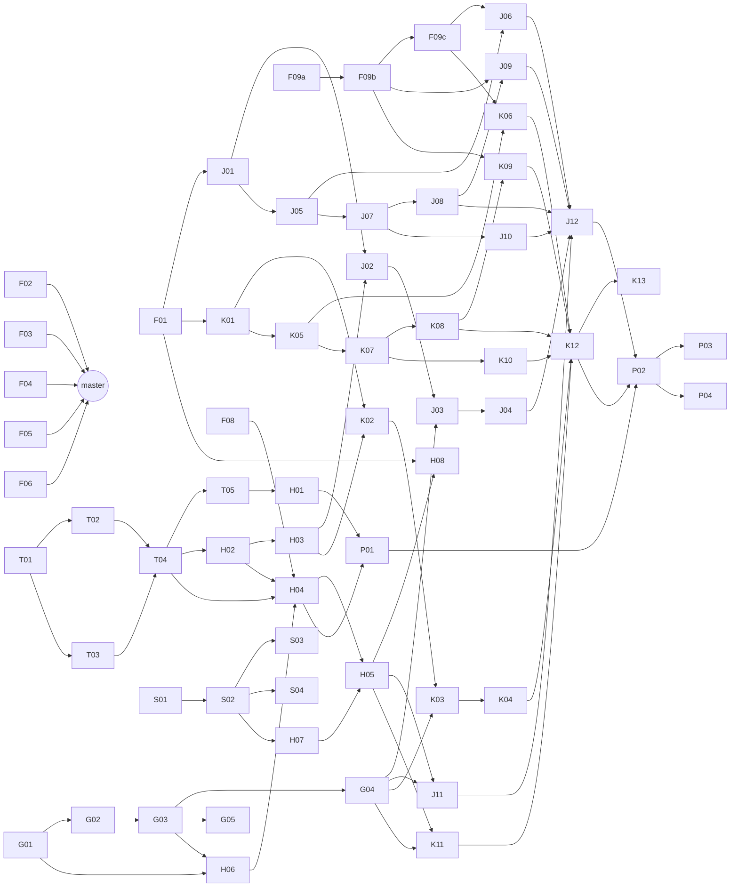

# NexNet multi-language clients: implementation plan (merge train)

Plan root (absolute path, because it is **not** in git):
`D:\tmp\claude\3e6f60a1964b5cb0\09da1c8b-e3e1-480e-b260-39064eaabd67\scratchpad\multilang-plan\`

| File | Purpose |
|---|---|
| `00-index.md` | This file: decisions, layout, merge-train rules, dependency graph, status |
| `01-context.md` | Shared technical context every agent needs (contracts, conventions, gotchas) |
| `02-feasibility-report.md` | The full investigation (copy of `docs/internals/java-js-client-feasibility.md`) |
| `cards/<ID>.md` | One self-contained work unit. An agent needs only `00-index.md`, `01-context.md` and its card |
| `cards/P01-shared.md` | Porting rules shared by every P01a–P01h card |
| `03-handoff-prompt.md` | Prompt that starts a fresh coordinator session on this train |

Repo: `D:\Projects\NexNet\NexNet-master` (GitHub `Dtronix/NexNet`). Base: `master` @ `ec02d2b` (0.20.0).

---

## 1. Goal

**Feasibility verdict:** feasible, no hard blockers (see `02-feasibility-report.md` §0).

Ship **client-only** Java and JavaScript libraries for NexNet. They must have **full feature parity** with the C# client.

The **existing C# source generator** emits the per-nexus code for each language:

- proxies
- client nexus bases
- MessagePack formatters

Each language also gets a hand-written static runtime.

**Every client test** runs against every client language through a C#-driven cross-language harness built on **TUnit**.

The server gains **multi-transport** support: one server, many listeners.

The design must let Rust and C++ be added later through the same IR and harness.

## 2. Decision log (final; supersedes §10 of the report)

| # | Topic | Decision |
|---|---|---|
| D1 | Scope | Client-only Java and JS; server stays .NET |
| D2 | JS | ESM, plain JS with JSDoc, ships `.d.ts`; browser + Node ≥ 22 |
| D3 | Java | Java 11 bytecode (`--release 11`), Android API 24+, `CompletableFuture`, Kotlin-friendly. Built with JDK 21 |
| D4 | Transports, Java | HttpSocket (TLS + plain), WS/WSS (own RFC 6455 client), **TCP, TcpTls**. **No UDS** |
| D5 | Transports, Node | HttpSocket (TLS + plain), WS/WSS, **TCP, TcpTls, UDS** |
| D6 | Transports, browser | WS/WSS only (platform limit) |
| D7 | Plaintext | Allowed. Every client (C# included) logs a once-per-client warning and exposes `IsSecure` |
| D8 | Parity policy | Nexuses opt in to targets. Awkward types get runtime shims. Anything not representable identically is a **generator error** |
| D9 | Opt-in surface | `Targets = NexusTargets.Java \| JavaScript` on the server `[Nexus]` attribute, plus `[assembly: NexusClientExport<TServer,TClient>]` |
| D10 | Output dirs | MSBuild properties per language (`NexNetJavaOutputDir`, `NexNetJavaPackage`, `NexNetJavaScriptOutputDir`), plus a generic `<NexNetTarget Include="lang" …/>` item |
| D11 | Getting files to disk | Generator emits a comment-only bundle `.g.cs`; a buildTransitive MSBuild target unpacks it after CoreCompile. No generator file IO (RS1035) |
| D12 | User `[NexusFormatter]` types | **Escape hatch in v1**: `[assembly: NexusTargetFormatter<T>(NexusTargets.X, "fq.native.Formatter")]`. The generator emits the native interface stub; a missing mapping is NEXNET040 |
| D13 | JS `long`/`ulong` | `bigint` by default. Opt-in checked `number` mapping per member or assembly |
| D14 | Java value types | Runtime `NexusDateTime`/`NexusTimeSpan`/`NexusDecimal`… with `java.time`/`BigDecimal` converters. No desugaring required |
| D15 | Browser auth | NexNet greeting token (`Authenticate`) is canonical for all clients. NexNet.Asp gets an opt-in query-string token hook (redacted in logs) and WebSocket `AllowedOrigins` |
| D16 | Keepalive | Per-endpoint server timeouts (multi-transport server). `ServerGreeting` advertises `idleTimeout`; clients derive their ping interval from it. Web Worker pings + lifecycle reconnect in browsers; lifecycle AAR on Android |
| D17 | Pre-send cancel | C# changes to throw `TaskCanceledException`. Java → `CancellationException`; JS → `AbortError` |
| D18 | Protocol versioning | **Pre-1.0: no version-byte policy change.** Server and all clients upgrade in lockstep. Wire changes in this train need no version bump |
| D19 | Package names | npm `@dtronix/nexnet`. Maven `com.dtronix:nexnet-client` plus optional `-android`, `-kotlin`, `-okhttp`, `-micrometer`. Java package `com.dtronix.nexnet`. Versions lockstep with NuGet |
| D20 | Client pool | Shipped in Java and JS |
| D21 | Multi-transport server | One `NexusServer`, many listeners: `AddListener`, `AddExternalEndpoint`, `Context.Endpoint` |
| D22 | Test framework | Migrate all tests to TUnit **before** building the harness |
| D23 | Test parity | C#-authored tests. Thin long-lived language host per language. Independent JSON control protocol over loopback TCP. Generated scriptable client nexus. Per-test leak audit. Host auto-restart |
| D24 | Test porting scope | Bucket A (client-facing, ~381 methods) runs on every language. Bucket B runs C#-only plus a cross-language smoke subset. C/D stay C# |
| D25 | Plan location | Session scratchpad (this folder). Agents read it by absolute path |
| D26 | Android | **JDK-only development** (any OpenJDK; Temurin 21 recommended, `--release 11`). Animal Sniffer checks against the Android API-24 signature from Maven; no Android SDK is needed. A **nightly** CI job installs the Android SDK and runs three checks: build the `-android` AAR, run D8/R8 at `--min-api 24`, and smoke-test on an API-24 emulator. Only `-android` module work needs the SDK locally |
| D27 | C# isolation | **C#-only by default.** `dotnet build src` / `dotnet test` never invoke Gradle or npm. Java and JS builds live under `clients/`, outside `src/`. Interop rows run only when `NEXNET_TEST_LANGS` lists languages; otherwise the only row is the C# in-proc driver. Generator tests for Java/JS emitters are text snapshots and need no SDK. `javac`/`tsc` compile checks are visibly skipped when the tool is missing and are mandatory in CI (`NEXNET_REQUIRE_SDKS=1`). The generator emits Java/JS only for projects that configure `NexNetTarget` |
| D28 | JS native tests | **Vitest**, run in Node for codec, golden vectors, framing, streams and runtime units. Vitest browser mode (Playwright provider) runs the browser-relevant units |
| D29 | Browser coverage | Every PR: Chromium, running the Vitest browser units plus the WSS interop smoke subset. Nightly: the full WSS bucket-A interop suite in Chromium, Firefox and WebKit |

## 3. Repository layout introduced by this train

```
src/NexNet.Generator/Ir/                 IR model, ShapeToIr, IrJson               (G01)
src/NexNet.Generator/Targets/            ITargetLanguage, registry, CodeWriter      (G03)
src/NexNet.Generator/Targets/Java/       Java emitters                              (K03, K04, K11)
src/NexNet.Generator/Targets/JavaScript/ JS emitters                                (J03, J04, J11)
src/NexNet.Generator/Targets/CSharpTest/ C# remote proxies and script facades       (H06)
src/NexNet.Generator/Validation/TargetValidator.cs                                  (G03)
src/NexNet.Generator/build/ & buildTransitive/  NexNet.Generator.props/.targets     (G04)
src/NexNet/NexusTargets.cs, Serialization/NexusTargetFormatterAttribute.cs …        (G02)
src/NexNet.TestNexus/                    shared test nexus interfaces + interop zoo (H02)
src/NexNet.Interop/                      harness: IClientUnderTest, drivers, host pool (H04, H05)
src/NexNet.InteropServer/                multi-endpoint test server host            (H07)
src/NexNet.GoldenVectors/                golden vector generator tool               (H03)
tests/golden/*.jsonl                     golden vectors (checked in)                (H03)
clients/js/                              npm workspace
  packages/nexnet/                       @dtronix/nexnet runtime                    (J01–J10)
  packages/interop-host-node/            Node language host                         (J12)
  packages/interop-host-browser/         browser host + Playwright launcher         (J12)
clients/java/                            Gradle multi-project (wrapper committed)
  nexnet-client/                         core runtime                               (K01–K10)
  nexnet-client-android|kotlin|okhttp|micrometer/                                   (K13)
  interop-host/                          JVM language host                          (K12)
```

## 4. Merge train

### 4.1 Branches

- **Train branch:** `train/multilang`, created from `master` by the coordinator before any unit starts.
- **Unit branch:** `mt/<ID>-<slug>`, for example `mt/G01-ir-model`. Created from the **current tip of `train/multilang`**, in its own git worktree.
- **Master-eligible units:** cards marked `Lands on: master` are independent bug fixes (F02–F06). They PR into `master`. The coordinator merges `master` into `train/multilang` right after each one lands. Everything else PRs into `train/multilang`.
- **End of train:** `train/multilang` merges into `master` in one PR. Optionally this happens at milestones M1–M4 (§6) when the train is green and releasable.

### 4.2 Unit lifecycle (agent)

1. Read `00-index.md`, `01-context.md` and your card. Do not start if a dependency's status is not `merged`.
2. Create a worktree from the tip of `train/multilang` (or `master` for master-eligible cards) on branch `mt/<ID>-<slug>`.
3. Stay inside the card's **Owns** list. If you must touch something else, stop and report. Never edit a **hot file** (§4.4) that the card does not list.
4. Commit in small logical commits. Message prefix: `[<ID>] `.
5. Before declaring done:
   - Rebase onto the latest train tip.
   - Run the card's **Verify** commands **and** the train gate (§4.3).
   - All must pass with zero warnings (`TreatWarningsAsErrors` is on for everything under `src/`).
6. Push and open a PR to the train branch. Title `[<ID>] <title>`. Paste the Verify output summary into the body.
7. Report back to the coordinator:
   - the PR link;
   - what changed;
   - any contract change;
   - any follow-up card needed.

   **Do not edit this plan folder.** Only the coordinator updates status.

### 4.3 Train gate (must pass before every merge)

**Layer 1, the C# gate.** It requires no JDK and no Node (D27), and it always runs.

```
dotnet build src -c Release
dotnet test src/NexNet.Serialization.Tests -c Release
dotnet test src/NexNet.Generator.Tests -c Release
dotnet test src/NexNet.IntegrationTests -c Release
```

- **After T01 lands:** the same commands under Microsoft.Testing.Platform. Filters use `--treenode-filter`.
An agent must also run the language gates below when its PR touches any of these:

- `clients/js/**`, `src/NexNet.Generator/Ir/**` or `src/NexNet.Generator/Targets/JavaScript/**`: the JS gate.
- `clients/java/**`, `Ir/**` or `Targets/Java/**`: the Java gate.

The coordinator's pre-merge CI run always runs every layer.

- **After J01 lands, add:**
  ```
  npm ci --prefix clients/js
  npm test --prefix clients/js
  npm run typecheck --prefix clients/js
  ```
- **After K01 lands, add:**
  ```
  clients/java/gradlew -p clients/java check
  ```
  `check` includes Animal Sniffer API-24.
- **After H08 lands:** the CI workflow runs the gate. The `interop` jobs are required only after J12/K12.

### 4.4 Merge rules (coordinator)

- **One merge at a time.** Merge in topological order of the DAG (§5). If a later-ready unit is green and conflict-free, it may merge before an earlier one.
- **Re-run the gate after each merge.** A failing train tip blocks all merges until it is fixed. The fix is either a revert or a hot-fix card.
- **Hot files:** shared files where only **one in-flight unit** may hold an edit at a time. The coordinator serializes these units.
  - `src/NexNet.Generator/DiagnosticDescriptors.cs`. IDs are pre-allocated in §4.5, so edits are append-only.
  - `src/NexNet.Generator/NexusGenerator.cs`
  - `src/NexNet.Generator/NexNet.Generator.csproj`
  - `src/NexNet/NexusServer.cs`
  - `src/NexNet/Transports/ConfigBase.cs`
  - `src/NexNet/Internals/NexusSession*.cs`
  - `src/NexNet/Messages/ServerGreetingMessage.cs`
  - `src/NexNet.IntegrationTests/BaseTests.cs`
  - `src/NexNet.slnx`
  - `src/Directory.Build.props`
  - `docs/internals/protocol-specification.md`
  - `llm-dev.md`
  - `llm-usage.md`
  - `llm-release.md`
  - `.github/workflows/*`
  - `clients/js/package.json`
  - `clients/js/packages/nexnet/package.json`
  - `clients/java/settings.gradle.kts`
  - `clients/java/gradle/libs.versions.toml`
- **Contracts are frozen when their card merges.** A contract change needs a dedicated `C-<n>` amendment card that updates every consumer in one PR. Contracts:
  - IR schema (G01)
  - runtime formatter API (J02/K02)
  - runtime generated-code API (J01/K01)
  - control protocol (H05)
  - golden format (H03)
  - `IClientUnderTest` (H04)

### 4.5 Pre-allocated identifiers (avoid merge collisions)

| Kind | Allocation |
|---|---|
| Generator diagnostics | NEXNET040 target-unrepresentable, 041 name collision, 042 duplicate/overloaded method names (F02), 043 Targets on client nexus, 044 target without output dir (warning), 045 unknown target or missing option, 046 reference-equality key (warning), 047 output file collision, 048 NexusTargetFormatter invalid (G02), 049 reserved for H06 |
| Test transports (`BaseTests.Type`) | append `WebSocketTls`, `HttpSocketTls` (H04) |
| Wire | `ServerGreeting` gains trailing field `idleTimeoutMs` (S04). Trailing-field rule: older readers ignore it |
| Hash test interfaces | none |

## 5. Dependency graph



Text form, for agents without mermaid. A unit may start once all of its prerequisites are `merged`.

| Unit | Requires |
|---|---|
| F01–F06, F08, F09a, T01, S01, G01 | nothing |
| F09b | F09a |
| F09c | F09b |
| T02, T03 | T01 |
| T04 | T02, T03 |
| T05 | T04 |
| H01 | T05 |
| S02 | S01 |
| S03, S04, H07 | S02 |
| G02 | G01 |
| G03 | G02 |
| G04, G05 | G03 |
| H06 | G03 |
| H02 | T04 |
| H03 | H02 |
| H04 | T04, H02, H06, F08 |
| H05 | H04, H07 |
| H08 | H05, F01 |
| J01 | F01 |
| J02 | J01, H03 |
| J03 | J02, G04 |
| J04 | J03 |
| J05 | J01 |
| J06 | J05, F09c |
| J07 | J05 |
| J08 | J07 |
| J09 | J08, F09b |
| J10 | J07 |
| J11 | G04, H05, J04 |
| J12 | J04, J06, J08, J09, J10, J11 |
| K01 | F01 |
| K02 | K01, H03 |
| K03 | K02, G04 |
| K04 | K03 |
| K05 | K01 |
| K06 | K05, F09c |
| K07 | K05 |
| K08 | K07 |
| K09 | K08, F09b |
| K10 | K07 |
| K11 | G04, H05, K04 |
| K12 | K04, K06, K08, K09, K10, K11 |
| K13 | K12 |
| P01a–P01h | H01, H04 (they run against C# in-proc first; JS/Java rows enable as J12/K12 land) |
| P02 | P01*, J12, K12 |
| P03, P04 | P02 |

**Maximum useful parallelism.** At the start, about 10 units can run at once:

- F01
- F02–F06
- F08
- F09a
- T01
- S01
- G01

After the foundations, the JS track (J*) and the Java track (K*) run fully in parallel with each other.

## 6. Milestones

| Milestone | Units | Meaning |
|---|---|---|
| M0 Foundations | F*, T01–T05, S01–S04 | Bugs fixed, spec complete, TUnit, multi-endpoint server. Releasable to master |
| M1 Generator + harness | G*, H01–H08 | IR, opt-in, bundle; harness runs the C# in-proc driver end to end |
| M2 JavaScript parity | J* + P01 JS rows green | `@dtronix/nexnet` passes all bucket-A tests (Node: all transports; browser: WSS subset) |
| M3 Java parity | K* + P01 Java rows green | `com.dtronix:nexnet-client` passes all bucket-A tests |
| M4 Ship | P02–P04 | Docs, lockstep release pipeline, public parity table |

## 7. Status board (coordinator-owned)

Status values: `todo`, `ready` (deps merged), `in-progress`, `review`, `merged`, `blocked`.

| ID | Title | Size | Lands on | Status | PR |
|---|---|---|---|---|---|
| F01 | Dev environment & CI toolchain (JDK/Gradle/Android SDK/Node/Playwright) | S | train | ready | |
| F02 | Generator: duplicate method names → NEXNET042; diagnostic locations | S | master | ready | |
| F03 | Pre-send cancellation throws `TaskCanceledException` | S | master | ready | |
| F04 | Unauthorized pipe/channel method sends Refused | S | master | ready | |
| F05 | C# client: async Authenticate, plaintext warning, `IsSecure` | S | master | ready | |
| F06 | NexNet.Asp: WS `AllowedOrigins` + opt-in query-string token | S | master | ready | |
| F08 | Regenerate test certificates (CA + SAN leaf) | S | train | ready | |
| F09a | Spec: handshake, ping, disconnect, pipes, limits, bit layouts (G1–G9, G12–G15) | M | train | ready | |
| F09b | Spec: collection synchronization protocol (G10) | M | train | todo | |
| F09c | Spec: transport bindings HttpSocket/WS/TCP (G11) | S | train | todo | |
| T01 | MTP runner switch (global.json, NUnit runner, CI, docs) | S | train | ready | |
| T02 | Generator.Tests → TUnit | S | train | todo | |
| T03 | Serialization.Tests → TUnit | M | train | todo | |
| T04 | IntegrationTests → TUnit (serial) | L | train | todo | |
| T05 | IntegrationTests parallel-safety | M | train | todo | |
| S01 | Server lifecycle fixes + internal endpoint refactor | M | train | ready | |
| S02 | Public multi-endpoint API, `Context.Endpoint`, ASP attach, hosted service | M | train | todo | |
| S03 | TLS/QUIC handshakes off the accept loop | S | train | todo | |
| S04 | Advertised `idleTimeout` in ServerGreeting; C# client pings from it | S | train | todo | |
| G01 | Generator IR + `nexnet-ir.json` | L | train | ready | |
| G02 | Opt-in surface: `NexusTargets`, `NexusClientExport`, `NexusTargetFormatter` | M | train | todo | |
| G03 | `ITargetLanguage`, capability tables, `TargetValidator` (NEXNET040–048) | M | train | todo | |
| G04 | Bundle emission + buildTransitive unpack target + MSBuild config | M | train | todo | |
| G05 | Hash parity tests (IR constants vs compiled C# client) | S | train | todo | |
| H01 | C# test refactor: remove client-only hooks, barriers, `T(x)` timeouts | L | train | todo | |
| H02 | `NexNet.TestNexus` + interop type zoo + server frame-injection hook | M | train | todo | |
| H03 | Golden vectors tool + `tests/golden` + C# replay | M | train | todo | |
| H04 | `IClientUnderTest`, ClientSpec, script interpreter, in-proc driver, ClientMatrix | M | train | todo | |
| H05 | Control protocol spec + remote driver + host pool supervisor + leak audit | L | train | todo | |
| H06 | Generator CSharpTest target: remote proxies + script facades | M | train | todo | |
| H07 | `NexNet.InteropServer` multi-endpoint test server | S | train | todo | |
| H08 | CI workflows: golden, interop matrix, nightly | M | train | todo | |
| J01 | JS workspace scaffolding + runtime API contract | S | train | todo | |
| J02 | JS MessagePack codec + value shims + golden verify | L | train | todo | |
| J03 | Generator JS formatter emitter (+ .d.ts) | L | train | todo | |
| J04 | Generator JS proxy / client-nexus emitter | L | train | todo | |
| J05 | JS session core | L | train | todo | |
| J06 | JS transports (WSS browser, RFC 6455 Node, HttpSocket, TCP/TLS, UDS) | M | train | todo | |
| J07 | JS invocations (both directions), credits, cancel, large msgs, auth | L | train | todo | |
| J08 | JS duplex pipes + channels | L | train | todo | |
| J09 | JS synchronized collections | L | train | todo | |
| J10 | JS reconnection, pool, logging, metrics, snapshots, counters | M | train | todo | |
| J11 | Generator JS test scaffolding | M | train | todo | |
| J12 | Node + browser interop hosts | M | train | todo | |
| K01 | Java Gradle scaffolding + runtime API contract | S | train | todo | |
| K02 | Java MessagePack codec + value shims + golden verify | L | train | todo | |
| K03 | Generator Java formatter emitter | L | train | todo | |
| K04 | Generator Java proxy / client-nexus emitter | L | train | todo | |
| K05 | Java session core (reader/writer threads, executors) | L | train | todo | |
| K06 | Java transports (HttpSocket, RFC 6455 WSS, TCP, TcpTls) | M | train | todo | |
| K07 | Java invocations (both directions), credits, cancel, large msgs, auth | L | train | todo | |
| K08 | Java duplex pipes + channels | L | train | todo | |
| K09 | Java synchronized collections | L | train | todo | |
| K10 | Java reconnection, pool, logging, metrics, snapshots, counters | M | train | todo | |
| K11 | Generator Java test scaffolding | M | train | todo | |
| K12 | JVM interop host | M | train | todo | |
| K13 | Optional Java modules: android, kotlin, okhttp, micrometer | M | train | todo | |
| P01a | Port tests: lifecycle & reconnection | M | train | todo | |
| P01b | Port tests: invocations, credits, large values, remote errors | L | train | todo | |
| P01c | Port tests: cancellation | M | train | todo | |
| P01d | Port tests: auth, authorization, versioning, TLS | M | train | todo | |
| P01e | Port tests: pipes, channels, flow control | L | train | todo | |
| P01f | Port tests: collections | L | train | todo | |
| P01g | Port tests: client pool | S | train | todo | |
| P01h | Cross-language smoke subset of bucket B | S | train | todo | |
| P02 | Public docs: parity table, Java/JS getting started, llm-usage | M | train | todo | |
| P03 | Lockstep release pipeline (npm + Maven Central + NuGet) | M | train | todo | |
| P04 | Train → master merge and release notes | S | train→master | todo | |

## 8. Agent briefing template (coordinator uses this to launch a unit)

> You are implementing work unit **<ID>** of the NexNet multi-language merge train.
>
> Read these files (absolute paths), in order:
> - `…\multilang-plan\00-index.md`
> - `…\multilang-plan\01-context.md`
> - `…\multilang-plan\cards\<ID>.md`
>
> Use `02-feasibility-report.md` only as a reference.
>
> Repo: `D:\Projects\NexNet\NexNet-master`. Create a worktree on branch `mt/<ID>-<slug>` from `<train/multilang | master>`.
>
> Follow §4.2 exactly:
> - stay within the card's **Owns** list;
> - pass the card's **Verify** commands and the train gate;
> - open the PR to `<base>`.
>
> Reply with:
> - PR link;
> - summary;
> - verification output summary;
> - contract changes;
> - follow-ups.
>
> Do not edit the plan folder.
